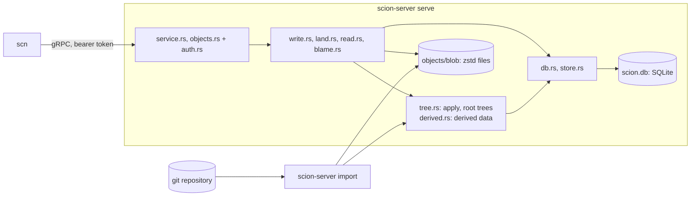
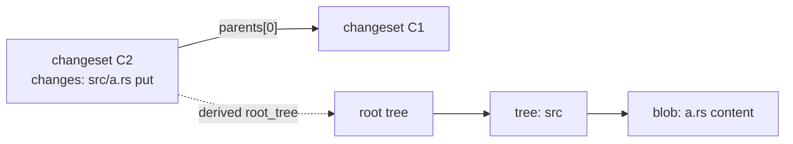
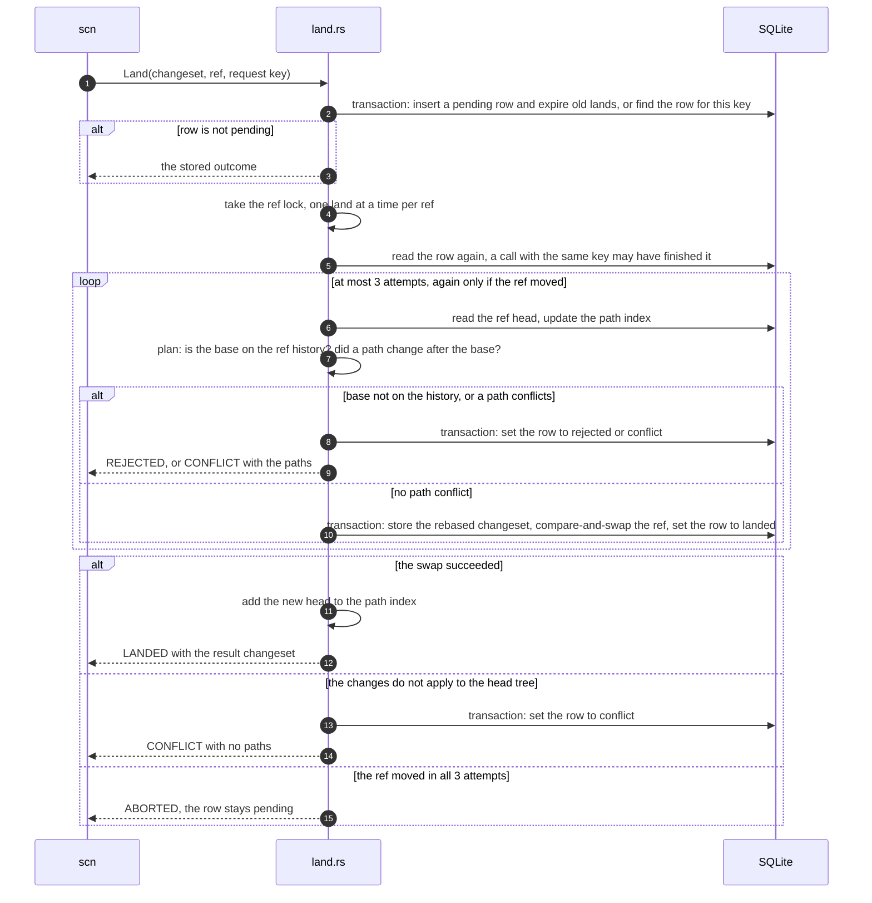
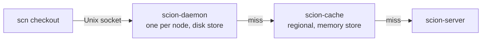

# Architecture

This document explains how open-scion works, for a new contributor who has
read the [README](../README.md). It describes the code on `main`. Parts that do
not exist yet are marked **planned**, with the issue that tracks them.
The design follows Anthropic's article
[Redesigning source control](https://www.anthropic.com/engineering/redesigning-source-control).
The README lists where this project makes its own choices.

## 1. Overview

| Crate | Role |
|---|---|
| [`scion-core`](../crates/scion-core) | Object model (`Changeset`, `Tree`, IDs, `RepoPath`) and the v1 encoder and strict decoder. No I/O. |
| [`scion-proto`](../crates/scion-proto) | gRPC types generated from [`proto/scion.proto`](../proto/scion.proto): the `Scion` and `Objects` services, whose contract is [`protocol-v1.md`](protocol-v1.md). Largest message 64 MiB (a `GetObjects` reply message: one object of up to 100 MiB), stream chunk 1 MiB. |
| [`scion-server`](../crates/scion-server) | One binary with two commands: `serve` (the API) and `import` (git import). |
| [`scn`](../crates/scn) | Command-line client: `cat`, `ls`, `log`, `blame`, `show`, `checkout`, `commit`, `land`, `bench`. |



How one request flows through the server:

1. `auth.rs` checks the bearer token and tags the request with a `Caller`.
2. `service.rs` (the `Scion` service) or `objects.rs` (the `Objects` service)
   checks names, IDs and paths, then runs `write.rs`, `land.rs`, `read.rs`
   or `blame.rs` on a blocking thread (SQLite and the blob folder are
   synchronous). Both services share one bound: at most 256 run at once,
   and at most 4 of them are `Blame` calls. A
   request times out after 600 s; for a streamed reply that covers only its
   start. A `GetObjects` reply ends when its client takes no object for
   120 s.
3. `error.rs` maps errors to gRPC codes. Database, I/O, git and corruption
   errors reply `INTERNAL`. The detail goes only to the server log.

## 2. Object model

Three kinds of objects. All are content-addressed and never change.

| Object | What it is |
|---|---|
| Blob | The raw bytes of one file, or the target of one symlink. |
| Tree | One directory level: entries sorted by raw name bytes, each a file state or a child tree. |
| Changeset | One commit: parents, author, optional committer, message, and the changed paths. |

**A changeset stores only first-parent deltas.** `parents[0]` is the diff
base. `changes` maps each path that differs from `parents[0]` to a new file
state or to a delete. Other parents, such as the second parent of a merge, are
recorded but not diffed. So a changeset's size grows with the change, not
with the repository. The full snapshot is derived data (section 4).

A file state is a regular file (blob and executable flag), a symlink (blob
that holds the target), or a gitlink (a git commit ID, no blob). Only git
import sets `committer`, creates a changeset with zero or several parents, or
creates a repo or a ref. No RPC creates a repo or a ref, so a new repo starts
with `scion-server import`.



**IDs.** Every ID is BLAKE3 over a domain prefix plus the object's canonical
bytes. Each kind has its own prefix (`scion\0blob\0v1\0`,
`scion\0changeset\0v1\0`, `scion\0tree\0v1\0`), so the same bytes get a
different ID as each kind. `BlobId`, `TreeId` and `ChangesetId` are distinct
Rust types. A blob ID hashes the uncompressed file bytes.

**Generation** is graph metadata, stored next to the changeset and not part of
the hash: 1 for a root, else 1 + the highest parent generation.

**Why the format is frozen.** An ID is a hash of the bytes, so any change to
the encoding changes every ID. The decoder accepts exactly one encoding per
object, so an accepted object re-encodes to the same bytes and the same ID.
Golden tests, property tests and a fuzz target pin this. A change needs a new
format version. [`format-v1.md`](format-v1.md) has the bytes, the path rules
and the decoder rules.

## 3. Storage

One data directory holds everything (`store.rs`):

```text
<data>/lock                    locked by the one process that uses <data>
<data>/scion.db                metadata and trees (SQLite)
<data>/objects/blob/ab/cd..    one zstd file per blob, named by its ID in hex
<data>/tmp/                    staging for atomic blob writes
```

**SQLite tables** ([`migrations/`](../crates/scion-server/migrations)):

| Table | Holds |
|---|---|
| `repos` | Repository name to `repo_id`. |
| `changesets` | ID, generation and `ChangesetV1` bytes. Global: one row per changeset, whatever repos have it. |
| `changeset_parents` | Parent `n` of each changeset, also indexed by parent. |
| `repo_changesets` | Which changesets a repo may read. Every changeset read checks this table. |
| `refs` | Ref name to target and `version`. A ref moves only by compare-and-swap on `version`. A foreign key keeps the target in the repo. |
| `lands` | One row per land request, unique on (repo, caller, request key): state, result, detail, conflict paths, and when it finished. A finished row expires after 7 days (section 5). |
| `trees` | `TreeV1` bytes by tree ID. Global. |
| `derived` | Derived values by (kind, version, changeset), as bytes that each kind encodes. Rebuildable (section 4). |
| `git_import` | Git commit ID to changeset, per repo, so a re-import skips known commits. |

Trees live in SQLite, not in the blob folder, so a derivation that writes many
trees commits them in one transaction. The schema version is
`PRAGMA user_version`. When a database opens, each migration in
`migrations/` that is newer than its version runs, in order, in its own
transaction. A released migration never changes. A build refuses a database
with a newer version. Version 3 lets a derived value have any length; the
upgrade copies every row. All database access goes through one connection behind
a mutex. Write transactions use `BEGIN IMMEDIATE`.

**Blob folder.** One zstd file per blob, at most 100 MiB uncompressed. A write
goes to a temp file in `tmp/`, is flushed, and is renamed into place. A read
unpacks the file and checks its hash. A check that does not need the content
(`Blobs::verify`, used by puts, `CreateChangeset` and import) streams the file
through the decoder into the hasher, so it holds the zstd window and small
buffers, not the whole blob. A file that does not match its ID, or that
unpacks to more than 100 MiB, is corrupt, and the next put of that content
replaces it.

**Durability rules.**

- Group commit: concurrent callers share one full drive flush (`F_FULLFSYNC`
  on macOS). Each caller first makes its writes reach the drive with a plain
  `fsync`, then waits for a full flush that starts after that, and one
  waiting caller runs it for all. A failed flush fails every caller that
  waited for it.
- A database transaction is durable when `Store::write` returns, or after a
  later `Store::flush`. WAL with `synchronous = FULL` ends each commit with a
  plain `fsync`. On macOS that can leave the commit in the drive cache, so
  `flush` waits for a shared full flush. SQLite runs no full flush of its own
  (`fullfsync = OFF`), except in checkpoints (`checkpoint_fullfsync`).
  Elsewhere the commit's `fsync` already flushes the cache. A land waits for
  the flush after it releases the ref's lock, so queued lands share it.
- A read waits too. If `Store::read` saw a commit that no full flush covers
  yet, it waits for one after it releases the database lock. So no reply
  shows a commit that a power loss can undo, such as a ref target from
  `ResolveRef` or a land state from `GetLand`. Where `fsync` already flushes
  the drive cache, no read waits. A land reads with `Store::read_unflushed`,
  because it flushes before it replies.
- A read that derives a value, such as the root tree for `GetRootTree`,
  waits for a full flush of that derivation before it replies (section 4).
  So a client never gets a tree ID that a power loss can undo.
- A blob is durable after `BlobBatch::sync`: a plain `fsync` of each blob file
  when written, then of each changed fan-out directory, then a shared full
  flush.
- No committed metadata may name a blob that a crash could lose. `PutBlob`
  syncs its blob before it replies. `CreateChangeset` reads back, hashes and
  syncs every blob it names before its transaction. Git import syncs one blob
  batch per 1,000 commits before the transaction that records them.
- A stored blob still costs a full flush when it is put again or named by a
  changeset: another batch may have written it and not synced yet.

**Data-directory lock.** `Store::open` takes an exclusive, non-blocking
`flock` on `<data>/lock` and holds it until the last `Store` clone is dropped.
Lands are serialized by an in-memory lock (section 5), which a second process
would not see. So `scion-server import` needs the server stopped.

## 4. Derived data

Derived data is computed from changesets and is not part of them.

**What the article says.** Everything that is not part of a changeset is
derived data, and one generic mechanism computes all of it. Each kind is
defined recursively: its value for a changeset is computed from its values
for that changeset's parents. For each kind, the server chooses to compute it
eagerly or to defer the work. Clients never see these structures, so the
server can change them without a client change.

**How this project does it** (`derived.rs`). Only two ideas in this table
come from the article: a value comes from the parents' values, and a kind is
computed eagerly or on demand. The rest is this project's choice.

| Part | Here |
|---|---|
| A kind | `derived::Kind`: a name, a version, and `derive`, a function from a changeset and its first parent's value to a value. Each kind encodes its value as bytes. |
| Inputs | The first parent's value only, because a changeset stores only its changes against its first parent (section 2). The article says "parents". |
| On demand | `derived::get` reads the stored value. If there is none, `derived::derive` walks first parents back to the nearest changeset with a stored value, then derives forward, oldest first, and stores each value. It is a loop, not recursion, so a long chain is safe. |
| Eager | A kind can also store its value when the changeset is written. `root_tree` does (below). |
| Storage | One `derived` row per (kind, version, changeset), written in the transaction that derives it. A large structure belongs in its own table, and the value is its ID, as `root_tree` keeps trees in `trees`. |
| A version bump | A new version reads and writes only its own rows. So the old rows become unused, and nothing rewrites them. The new version derives its values again, on demand. Nothing removes the old rows yet ([#71](https://github.com/bnsd55/open-scion/issues/71)). |
| Repos | Rows are keyed by changeset alone. A changeset ID fixes its whole history, so a value is the same in every repo. `get` and `derive` check `repo_changesets` first, so a stored value never leaks to a repo that cannot see the changeset. |
| Durability | A value can name rows that its derivation wrote, such as trees, and a reply can send it to a client. So when `get` derives a value, it waits for one full flush, shared with concurrent commits, before it returns. `derive` and `put` never flush: inside a write, the write's own flush covers them. |
| One answer | A second write of a value must equal the first, or the store reports corruption. |

**Cost of a new kind or version.** The first read derives every missing value
on the chain in one transaction, and holds the database lock while it runs.
For a tip with a long history, that is the whole history at once. **Planned:**
a backfill that derives a bounded number of changesets per transaction
([#71](https://github.com/bnsd55/open-scion/issues/71)).

**Root trees.** Kind `root_tree` version 1 (`tree::RootTree`): the root tree
of a changeset's full snapshot, as a 32-byte tree ID. It is the first
parent's root tree plus the changeset's changes. It is eager.
`tree::store_changeset`, the one write path for changesets (`CreateChangeset`,
`Land`, git import), does this in the caller's transaction: apply the
changes, store the new trees, insert the changeset, record its `root_tree`.
If the row is missing, `tree::root_tree` derives it on demand. A golden test
pins the tree IDs of a fixed history, both when they are stored at write time
and when they are derived on demand.

`tree::apply` runs all deletes before all puts, so one changeset can turn a
file into a directory or back. It loads only the directories on changed paths
and removes directories left empty. It fails on a delete of a missing path or
of a directory, and on a put where a file or a directory is in the way.

**Path history and blame are not derived data yet.** The article says
Scion builds dedicated structures for file blame and path history from the
changesets, through the same mechanism. Here both are computed on each call
from first-parent changes, with a bound per call (section 7). That is this
project's choice for now. **Planned:** both as kinds on this mechanism
([#61](https://github.com/bnsd55/open-scion/issues/61)). A unit test shows
that a kind with another value type, which is derived only on demand, works
the same way.

## 5. The write path

An agent writes in three steps. Only the last one moves a ref.

1. `PutBlob` for each new file, in 1 MiB chunks. Returns the blob ID.
2. `CreateChangeset` with `ChangesetV1` bytes. Returns the changeset ID.
3. `Land` rebases the changeset onto a ref and moves the ref.

All three are safe to repeat. A land retry must reuse its request key.
`GetLand(land_id)` returns the stored state of a land that the same caller
started.

**CreateChangeset** (`write.rs`):

1. Decode strictly, with at most 100,000 changes. A larger change count is
   refused before any change is read.
2. Check the request: exactly one parent, no committer, a message of at most
   1 MiB, author name and email of at most 1 KiB each.
3. Check that the repo exists and has the parent, so a bad request reads no
   blob.
4. Read back each blob it names, outside the database lock. A blob that many
   paths name is read once. The error names the first path, in path order,
   whose blob is missing or corrupt.
5. In one write transaction: check the repo and the parent again. If the repo
   already has this ID, return it (a retry). Then `tree::store_changeset`.
   Changes that do not apply to the parent's tree are `INVALID_ARGUMENT`.

**Land** (`land.rs`):



- **Retries by request key.** The caller chooses the key, unique per
  (repo, caller). A retry with the same key finds the same row: a finished
  land returns its outcome, a pending one resumes. The same key with a
  different changeset or ref is `INVALID_ARGUMENT`. `scn land` uses
  `<changeset ID>:<ref>` as the default key.
- **Retention.** A finished land (landed, conflict or rejected) is kept for
  7 days after it finished (`LAND_RETENTION_SECS`). A pending land is kept
  until a retry finishes it. Each new land deletes up to 100 expired lands,
  oldest first, in the transaction that records it. The newest land always
  stays, so a land ID is never given out twice. The upgrade to schema
  version 2 gives older finished lands the time of the upgrade, so their
  7 days start then.
- **A retry after expiry** is a new land with a new ID, and `GetLand` with
  the old ID returns `NOT_FOUND`. It cannot land the changeset twice: the
  landed copy changed every path of the changeset after its base, so the new
  land is a conflict. The exception is a changeset with no changes: it lands
  again as one more empty changeset, and no file changes.
- **The rebase** is the input changeset with its parent replaced by the ref
  head. Changes, author and message stay the same. If the base is already the
  head, the result is the input changeset itself.
- **Crash safety.** The pending row commits before any other work. One
  transaction then stores the rebased changeset and its root tree, moves the
  ref, and marks the row landed. A crash leaves a pending row (a retry
  finishes it) or a landed row (a retry returns it), never a moved ref
  without a landed row. The ref lock is one mutex per (repo, ref), in process.
- **Durable before the reply.** Every reply waits for a full flush that covers
  the land's transactions (`Store::flush`). The land releases the ref lock
  first, so the lands queued behind it share that flush.
- **ABORTED on contention.** Only git import moves a ref without the ref lock.
  The data-directory lock keeps the `import` command and the server apart, so
  this race needs both in one process, as in the tests. If the
  compare-and-swap fails, the transaction rolls back and the land is planned
  again from the new head. After 3 attempts the call fails with `ABORTED` and
  the row stays pending. The caller retries with the same key. `scn land`
  does not retry. Run it again: the default key is the same.
- **Outcomes.** `CONFLICT` and `REJECTED` are land states in a successful
  reply, not gRPC errors. A land to a missing ref is rejected at once. If the
  path check passes but the changes do not apply to the head tree, the land
  is a conflict with no paths.

**The path index.** Each ref slot holds an in-memory `PathIndex` over the
ref's first-parent history, from a `floor` changeset to the `tip`:

- `files`: path to the newest generation that put or deleted it,
- `dirs`: directory to the newest generation that changed anything below it.

It is built on the first land to a ref. It grows forward when the ref moves,
and backward when a land has an older base, down to `MAX_DEPTH` (one cycle,
10,000) generations below the tip. If the head does not descend from the tip,
it starts over. After an error other than `ABORTED` it is dropped and
rebuilt, because it may be ahead of the database.

A changed path `p` conflicts when one of these is newer than the base:
`files[p]` (the same path changed), `dirs[p]` (something below `p` changed),
or `files[d]` for a directory `d` above `p` (a file at a parent path changed).

**Why `generation > base_gen` means "changed after the base".** A child's
generation is at least 1 + its first parent's. So generations strictly
increase along a first-parent chain. The index holds only changesets on the
ref's first-parent chain, and a land is rejected unless its base is on that
chain. On such a chain, a changeset comes after the base exactly when its
generation is greater than the base's. So a path changed after the base
exactly when its newest generation in the index is greater than `base_gen`.
The check costs one lookup per path part, not a walk over history. A merge's
changes are its diff against its first parent, so paths that a merge brought
in are indexed at the merge's generation.

```text
gen        10        11          12          13
main:      B ─────── X ───────── Y ───────── H   (head)
                     puts a.rs   puts b/c.rs

land of a.rs, base B   files["a.rs"] = 11 > 10    conflict
land of b,    base B   dirs["b"]     = 12 > 10    conflict
land of d.rs, base B   no entry                   lands on H
```

**Pruning.** The index works in cycles of 10,000 generations of the tip.
During a cycle it notes the oldest base that a land used. When the cycle
ends, the floor moves up to that base, or to the tip at the cycle start if no
base was older. Every entry at or below the new floor is dropped. So memory
follows the oldest base in use, not the time since the server started. A
base that a cycle used stays in the index until the next cycle ends.

A base more than `MAX_DEPTH` generations below the tip is not added to the
index and does not count as used. So however old the bases are, they keep
at most about three cycles of history in the index. Such a base is rare: a
client lands soon after it reads the head.

**Why pruning cannot hide a conflict.** After a prune, the index still holds,
for each path, the newest generation that changed it after the floor. A
land's base is at or above the floor, or below it:

- At or above the floor: every dropped entry has a generation at or below the
  floor, so at or below `base_gen`. It never counts as newer than the base,
  so the check gives the same answer as before the prune.
- Below the floor, at most `MAX_DEPTH` below the tip: `reach` walks the
  history in the database from the floor back to the base, and adds each
  changeset it passes. The index then holds every change after the base
  again.
- Below the floor and deeper: the same walk runs, but adds nothing to the
  index. It keeps only what the three conflict rules read for the land's own
  paths. The index holds the changes after the floor, and the walk sees the
  changes from the floor back to the base. A path changed after the base
  exactly when one of the two says so, so the answer is the same as with one
  index. Memory follows the size of the land, not the depth of the base.

So the choice of the new floor, and of `MAX_DEPTH`, changes only the speed,
never the answer.

**Planned:** a lander that rebases a batch of pending lands and moves the ref
once ([#18](https://github.com/bnsd55/open-scion/issues/18)).

## 6. Git import

`scion-server --data DIR import [--repo main] [--rev HEAD] [--ref main] [--verify 100] GIT_DIR`
imports one way, from a local git repository. It needs the server stopped
(the data-directory lock). Only SHA-1 repositories are supported.

**Mapping.**

- Each git commit becomes one changeset. Its parents are the changesets of the
  git parents, in git order. Its changes are the git tree diff against the
  first parent. Subtrees with the same git ID on both sides are skipped.
- Author and committer are kept. The `encoding`, `gpgsig` and `mergetag`
  headers are dropped. Changeset IDs are not git commit IDs.
- Modes `100644`/`100664`, `100755`, `120000` and `160000` become regular,
  executable, symlink and gitlink entries. Any other mode, a path that breaks
  the path rules, or a file over 100 MiB fails the import.

**Order and batches.**

1. Walk every commit reachable from `--rev`, parents first, with an explicit
   stack. Commits already in `git_import` are not imported again.
2. For each batch of 1,000 commits, build the changesets, write new blobs into
   one blob batch, and sync it.
3. In one transaction, store each changeset with `tree::store_changeset`,
   record its `git_import` row, and verify the sampled commits. A failed check
   rolls back the batch. Earlier batches stay, so a rerun continues.
4. Point the ref at the tip.

**Verification.** Every new root and merge commit is checked, plus `--verify`
other new commits, evenly spaced and ending at the newest. A check compares
the Scion root tree with the git tree, entry by entry: names, kinds,
executable flags and content hashes. It also checks that each blob file is
stored intact.

**Forward-only refs.**

| The ref today | Result |
|---|---|
| does not exist | created at the tip |
| is the tip, or already contains it (lands made after an earlier import) | left alone |
| is an ancestor of the tip | moved forward to the tip |
| anything else (diverged) | the import fails, the ref is left alone, the commits stay imported |

## 7. The read path

Every read except `ResolveRef` names an immutable object (a changeset, tree
or blob ID), never a ref, so any cache tier can answer it. A client resolves
a ref first. `scn` accepts a ref name or a 64-digit changeset ID wherever it
takes a revision, and resolves refs through `Objects`.

**Path reads (`Scion` service).**

| RPC | Answer |
|---|---|
| `ResolveRef` | The changeset a ref points at. The only mutable answer. |
| `GetChangeset` | `ChangesetV1` bytes. |
| `ReadFile` | A regular file's content, or a symlink's target, in 1 MiB chunks. |
| `ListDir` | One directory level as `TreeV1` bytes. |
| `Log` | First-parent history, newest first. With a path, only the changesets that change it. A reply holds at most 1,000 entries and about 32 MiB, and checks at most 1,000 changesets. `next_changeset_id` says where to continue. `scn log` asks again until it has `-n` entries. |
| `Blame` | For each range of lines in a file, the changeset that last changed it on first-parent history, and that changeset's author and time. |

**Path history** (`Log` with a path, `read::log_page`). The walk follows
first parents from the given changeset, newest first. It returns each
changeset that changes the path: the file itself, or anything below it if it
is a directory. A changeset lists every file it changes against its first
parent, so the check reads no trees. A commit on a merged branch never
appears; the merge appears when its diff against its first parent changes
the path. The article stores changes against the first parent because people
care about history and blame only for commits on the main line.

**Blame** (`blame.rs`). The article does not describe how blame is
computed. These steps, the diff and the bounds below are this project's
choices. For a file at a changeset:

1. Read the file. A directory, a symlink, a submodule, a file over 1 MiB or a
   file with a NUL byte is `INVALID_ARGUMENT`.
2. Walk first parents to the next changeset C that changes the path. Read the
   version in C's first parent, and diff it with C's version, line by line.
   The lines that C added go to C. The other lines move to their place in the
   older version.
3. Repeat from C's first parent until every line has a changeset. If the
   older version does not exist, or is not text that blame reads, every line
   left goes to C. So a file deleted and added again starts over, as in git.

Renames are not followed: the walk looks at one path, so after a rename
every line goes to the rename. `git blame` follows renames
([#69](https://github.com/bnsd55/open-scion/issues/69)).

The diff is Myers with an indent heuristic, from `gix` (`gix::diff::blob`),
already a dependency for the import. `git blame` also uses Myers by default.
Where several minimal diffs exist, for example around repeated lines, the
two can place a line differently, so the blame can differ from git there. A
test compares the result with `git blame --first-parent`, line by line, on a
history where they agree.

**Bounds and resume.** A `Log` or `Blame` call checks at most 1,000
changesets (`MAX_SCAN`), so it holds the database lock no longer than a plain
`Log` of 1,000 entries. A `Blame` call also diffs at most 100 versions, and
about 1M lines (`MAX_BLAME_DIFF_LINES`, both sides of each diff). The first
diff of a call always runs, so a call always makes progress. A diff of many
repeated lines is slow, so the worst case of one call is one diff of two
1 MiB files. At most 4 `Blame` calls run at once, so they never take more
than 4 of the permits that writes and lands share. When a call stops at a
bound, `next_changeset_id` names where to continue. A `Log` reply can then
have no entries. In a `Blame` reply, the
ranges left have no changeset, and `origin_line` gives their line in the file
at `next_changeset_id`. A blame of the same path there continues the work
exactly. `scn log --path` and `scn blame` ask again until they are done.
Path history and blame as derived data will remove these bounds
([#61](https://github.com/bnsd55/open-scion/issues/61)).

`ReadFile` and `ListDir` get the changeset's root tree from `derived`
(deriving it if the row is missing), then walk trees from SQLite one path part
at a time. `ReadFile` then reads the blob file, unpacks it, checks its hash,
and streams it. Every read checks that the repo has the changeset. `scn`
checks that each changeset it receives hashes to its ID.

**Object reads (`Objects` service, `objects.rs`).** The calls that every
cache tier will answer. The client asks only for the objects it wants,
starting at the root tree, and never says what it already has.

| RPC | Answer | Cache |
|---|---|---|
| `ResolveRef` | Same as on `Scion` (one shared implementation). | Never: a tier forwards it. |
| `GetRootTree(changeset)` | The root tree ID, from `derived`. Checks that the repo has the changeset. | Forever: a changeset never changes. |
| `GetObjects(refs)` | Streams the trees (`TreeV1` bytes) and blobs (raw content) named by `(kind, id)`, one object per message, in request order. | Forever. |

- A call names 1 to 1,000 objects. A task reads them one at a time, checks
  each against its ID, and hands it to the reply through a one-slot channel.
  A tree goes out as its stored bytes, which are canonical.
- Memory: before an object is read, its size comes from the store (a blob's
  zstd frame header, a tree's stored length), and the object takes that
  share of a server-wide budget of 400 MiB. It keeps the share until the
  reply takes it from the channel. With the budget spent, a reply waits
  holding no object bytes. A reply whose client takes no object for 120 s
  ends and frees its share. A blob read back larger than its header said is
  corrupt and is never sent. Not counted: one encoded object per reply inside
  HTTP/2, which stays until the connection closes
  ([#42](https://github.com/bnsd55/open-scion/issues/42)).
- A reply stops early once it has sent 64 MiB, always after at least one
  object. The client asks again for the rest, so one call stays short and a
  transfer can resume. A reply message fits one object of up to 100 MiB.
- A missing object fails the call with `NOT_FOUND`. Trees and blobs are
  global: any repo name that exists can read any object by ID
  ([#13](https://github.com/bnsd55/open-scion/issues/13)).

**What the client checks, and what it trusts.** Every tree and blob is
checked against its ID on arrival, so no tier can change an object. Two
answers cannot be checked that way: the changeset a ref points at
(`ResolveRef`) and the root tree of a changeset (`GetRootTree`). The client
trusts the server for both. The tiers
([#5](https://github.com/bnsd55/open-scion/issues/5)) must forward these
answers, or cache what the server said; they must never compute or invent
them.

**`scn checkout REV [--sparse DIR]... --into PATH`** (`scn/src/cmd/checkout.rs`)
uses only `Objects`:

1. Resolve REV, then `GetRootTree`.
2. Fetch one tree level per `GetObjects` batch. Each tree must hash to the
   ID that was asked for. Keep only the entries inside the sparse
   directories (each selects itself and everything below it) and the
   directories above them. A sparse path that is not in the tree is an error.
3. Check every kept name (below). Submodules are skipped with a note.
4. Only after the whole walk passes: make an empty temp directory next to
   the destination, fetch the blobs in batches, check each blob's hash, and
   write each file into the temp directory as its blob arrives.
5. Rename the temp directory onto the destination. On any failure the temp
   directory is removed, and the destination stays as it was. So the
   destination's parent must be writable, the destination cannot be a mount
   point, and an existing empty destination is replaced: its mode and owner
   are not kept ([#44](https://github.com/bnsd55/open-scion/issues/44)).

**Checkout-safe writes** (`scn/src/materialize.rs`). The object format
accepts names that are not safe to write, so the checkout adds its own rules:

| Rule | Why |
|---|---|
| The checkout is written into a temp directory, `.scn-checkout-<16 random hex digits>`, made with mode 0700 by `mkdirat` through a handle on the destination's parent. Just before the rename, it gets the mode of a plain `mkdir` (0777 less the umask). One `renameat` then moves it onto the destination name. | The rename is the check: it replaces a missing or empty directory, and fails if the destination is a non-empty directory, a file or a symlink. So "new or empty, not a symlink" holds at the moment the files appear. An early check gives a clear error first, but correctness comes from the rename. Other users cannot guess the temp name, or enter or write the directory. But a user who can write the destination's parent can still rename it and put another directory in its place, so that parent must not be writable by other users, unless it has the sticky bit. A killed `scn` can leave the temp directory behind. |
| Inside the temp directory, each parent is opened with `O_NOFOLLOW`, one part at a time. Files use `O_CREAT \| O_EXCL`. | A symlink in the way, from this checkout or from anything else, fails the write instead of redirecting it. |
| The temp directory starts empty, and the checkout records every path it makes. A path that already exists without being recorded is a collision. | The filesystem folded two names into one, by case or by Unicode form (for example `A` and `a`, or `X/f` and `x/g`, on macOS). The error names the path, and the temp directory is removed. Where nothing folds, every name is written, as git does. |
| Symlinks are written as symlinks with their raw target bytes, never resolved. | A target such as `../../etc` is data, not a path to follow. |
| Executable files get mode 0777, others 0666, less the umask. | The same modes as `git checkout`. |
| No control character (C0, DEL, C1, or a byte 0x80 to 0x9F that is not UTF-8), no bidirectional text control (U+202A to U+202E, U+2066 to U+2069), and no `.git` or `.scion` part, in any ASCII case. The walk checks every name before anything is written, and the writer checks every part again. | Names are printed, escaped, in errors and notes, and must not rewrite a terminal or read as another name. Tools trust metadata directories. |

The article says one `scion-daemon` stores objects for the whole node and is
reached over a socket. It talks only to a regional `scion-cache`, which serves
objects from memory. Every tier answers identical calls, and no tier skips the
next one. **Planned** ([#5](https://github.com/bnsd55/open-scion/issues/5)):
both tiers, answering the `Objects` calls above. The Unix socket, the call
names and access tickets are this project's choices:



Related planned work: a checkout benchmark against `git clone`
([#6](https://github.com/bnsd55/open-scion/issues/6)), and virtual checkout,
where files load when first read
([#11](https://github.com/bnsd55/open-scion/issues/11)).

## 8. Security model

open-scion is a proof of concept for one trusted machine. Do not expose it to
an untrusted network.

| Area | Today | Limit |
|---|---|---|
| Authentication | One static bearer token (`--token` or `SCION_TOKEN`). The server compares BLAKE3 digests of the tokens in constant time. | Every caller is the same principal, `default`. No users or per-folder rules ([#13](https://github.com/bnsd55/open-scion/issues/13)). |
| Network | Listens on `127.0.0.1:7878` by default. A non-loopback address is refused unless `--insecure-listen` is given. | No TLS: the token and all data travel unencrypted ([#14](https://github.com/bnsd55/open-scion/issues/14)). |
| Repo isolation | Changesets and derived root trees are reached only through `repo_changesets`. | Trees and blobs are shared by all repos. `GetObjects` reads any tree or blob by ID, and a changeset can name another repo's blob and then read it ([#13](https://github.com/bnsd55/open-scion/issues/13)). |
| Lands | `GetLand` and request keys are scoped by caller. | With one principal, all callers share one scope. |
| Input limits | Strict, fuzzed decoder. Messages up to 64 MiB (a `GetObjects` reply message up to 100 MiB plus 1 KiB), blobs up to 100 MiB, 16 uploads at once, 1,000 objects per `GetObjects` call. `GetObjects` replies share a 400 MiB budget, and a reply whose client stops reading ends after 120 s. Names of 1 to 256 bytes with no control characters. A `Log` or `Blame` call checks at most 1,000 changesets; `Blame` reads files of at most 1 MiB, diffs at most 100 versions and about 1M lines, and at most 4 run at once. | No per-principal quotas ([#15](https://github.com/bnsd55/open-scion/issues/15)). Finished `lands` rows expire after 7 days, pending ones stay (section 5). Each stalled reply keeps one encoded object inside HTTP/2 until its connection closes ([#42](https://github.com/bnsd55/open-scion/issues/42)). |
| Object integrity | The client checks every tree and blob against its ID, so a server or tier cannot change an object. | The client trusts the server for a ref's target and for a changeset's root tree, which it cannot check by hash. Tiers ([#5](https://github.com/bnsd55/open-scion/issues/5)) must forward these answers, not compute them. |
| Checkout | `scn checkout` writes into a private temp directory with a random name and renames it onto a new or empty destination, never follows a symlink while writing, fails on names that the filesystem folds together, and refuses control characters, bidirectional text controls, `.git` and `.scion` before it writes anything (section 7). On failure the destination stays as it was. | The destination's parent must not be writable by other users, unless it has the sticky bit: they could swap the temp directory before the rename. No Windows rules: device names and names that end in a dot or a space pass. |
| Errors | Internal errors reply `internal error`. The detail stays in the server log. | |

The planned cache tiers will need access tickets, because an object ID is not
a permission ([#13](https://github.com/bnsd55/open-scion/issues/13)). Report
security problems as described in [SECURITY.md](../SECURITY.md).

## 9. Deliberate shortcuts

Each deliberate simplification is marked `SHORTCUT:` in the code, with its
limit and its upgrade path. This is the list on `main` today.

| File | Shortcut | Upgrade | Issue |
|---|---|---|---|
| `scion-core/src/codec.rs` (`put_len`) | Encoding panics if a field is longer than `u32::MAX`. Every ingest path caps sizes far below that. | `try_encode` returning `Result`, if a path ever does not. | |
| `scion-server/src/store.rs` (`MAX_OBJECT_BYTES`) | An upload is buffered in memory, up to 100 MiB, before it is hashed and written. | Stream to a temp file and hash the chunks. | [#16](https://github.com/bnsd55/open-scion/issues/16) |
| `scion-server/src/store.rs` (`Inner::db`) | One SQLite connection behind a mutex, so reads wait for writes. | A pool of read-only connections. | [#17](https://github.com/bnsd55/open-scion/issues/17) |
| `scion-server/src/store.rs` (`Store::open`) | One process per data directory, so an import needs the server stopped. | Let a separate importer process share the directory. Lands already re-plan when the ref moves (`MAX_ATTEMPTS`). | [#27](https://github.com/bnsd55/open-scion/issues/27) |
| `scion-server/src/store.rs` (`BlobBatch::keep`) | Keeping a stored blob costs a full flush, because another batch may not have synced it. | Track the blobs written but not yet synced, and flush every blob directory and the drive at open. | [#35](https://github.com/bnsd55/open-scion/issues/35) |
| `scion-server/src/derived.rs` (`derive`) | One transaction derives every missing value on the chain, and holds the database lock. So the first read after a new kind or a version bump derives the whole history at once. Rows of old versions are never removed. | A backfill that derives a bounded number of changesets per transaction, and a bounded delete of old versions. | [#71](https://github.com/bnsd55/open-scion/issues/71) |
| `scion-server/src/write.rs` (`create_changeset`) | Blobs are shared by all repos. Safe with one principal. | A `repo_blobs` table, checked in `CreateChangeset`. | [#13](https://github.com/bnsd55/open-scion/issues/13) |
| `scion-server/src/land.rs` (`MAX_ATTEMPTS`) | Imports move refs without the land lock, so a land retries 3 times, then returns `ABORTED`. | Route every ref move through the per-ref lander. | [#27](https://github.com/bnsd55/open-scion/issues/27) |
| `scion-server/src/land.rs` (`Lands::land`) | An in-process lock serializes lands per ref, so this works with one server process. | One lander per ref that rebases a batch and moves the ref once. | [#18](https://github.com/bnsd55/open-scion/issues/18) |
| `scion-server/src/land.rs` (`MAX_DEPTH`) | A land on a base more than `MAX_DEPTH` generations below the tip walks the history from the index floor back to the base, each time, and holds the database lock while it walks. | Per-path history in the database, so the check reads only the paths that the land changes. | [#38](https://github.com/bnsd55/open-scion/issues/38) |
| `scion-server/src/objects.rs` (`read_object`) | An object ID is treated as permission to read it; trees and blobs are shared by all repos. Safe with one principal. | A read ticket bound to a principal, a repo and a root tree, checked by the server and every tier. | [#13](https://github.com/bnsd55/open-scion/issues/13) |
| `scion-server/src/objects.rs` (`STALL_TIMEOUT`) | A stalled `GetObjects` reply ends, but HTTP/2 keeps the one encoded object it was sending until the connection closes. | A response body timeout that resets the stream. | [#42](https://github.com/bnsd55/open-scion/issues/42) |
| `scion-server/src/objects.rs` (`send_objects`) | Two blocking hops per object (size, then read) and no read-ahead, so many small objects are read one after another. | Read a batch capped by bytes per hop, or keep a few reads in flight. | [#6](https://github.com/bnsd55/open-scion/issues/6) |
| `scion-server/src/read.rs` (`MAX_SCAN`) | Path history and blame walk first parents on every call, at most 1,000 changesets per call. A path changed long ago costs many calls. | Path history as derived data. | [#61](https://github.com/bnsd55/open-scion/issues/61) |
| `scion-server/src/blame.rs` (`MAX_BLAME_VERSIONS`) | One call diffs at most 100 versions of a file. A file with more versions costs more calls. | Blame as derived data, kept per file version. | [#61](https://github.com/bnsd55/open-scion/issues/61) |
| `scion-server/src/blame.rs` (`MAX_BLAME_DIFF_LINES`) | One call diffs about 1M lines. A diff of many repeated lines grows faster than its lines, so one diff of two 1 MiB files is the worst case of a call. | Blame from derived data, so a call does not diff whole versions. | [#62](https://github.com/bnsd55/open-scion/issues/62) |
| `scion-server/src/blame.rs` (`blame`) | Renames are not followed: after a rename every line goes to the rename. `git blame` follows it. | Rename detection, so the walk continues at the old path. | [#69](https://github.com/bnsd55/open-scion/issues/69) |
| `scion-server/src/blame.rs` (`MAX_BLAME_BYTES`) | A file over 1 MiB, or with a NUL byte, is refused. An older version like that counts as absent, so its lines go to the changeset that replaced it. | Blame from derived data, so a call does not diff whole versions, then a higher limit. | [#62](https://github.com/bnsd55/open-scion/issues/62) |
| `scion-server/src/auth.rs` (`Auth`) | One static token, one principal. | A token-to-principal map, then per-path write rules. | [#13](https://github.com/bnsd55/open-scion/issues/13) |
| `scion-server/src/main.rs` (`serve`) | No TLS. | Tonic TLS or mTLS before any deployment beyond one machine. | [#14](https://github.com/bnsd55/open-scion/issues/14) |
| `scn/src/client.rs` (`lossy`) | Non-UTF-8 names and messages print with replacement characters, also in JSON. | Escape or base64 raw bytes in JSON. | |
| `scn/src/cmd/commit.rs` (`commit`) | Reads each local file whole, so memory caps the file size. | Stream chunks from the file. | |
| `scn/src/cmd/commit.rs` (`commit`) | The author time zone is always UTC. | A time zone crate. | |
| `scn/src/materialize.rs` (`check_name`) | No Windows rules: device names (`CON`, `NUL`) and names that end in a dot or a space pass. | Per-platform rules before checkout runs on Windows. | [#45](https://github.com/bnsd55/open-scion/issues/45) |
| `scn/src/materialize.rs` (`Checkout`) | The checkout is renamed onto the destination, which needs a writable parent and replaces an existing empty directory. On an error the temp directory is removed by path. | Build inside an existing empty destination, and work only through directory handles. | [#44](https://github.com/bnsd55/open-scion/issues/44) |
| `scn/src/materialize.rs` (`Checkout::parent`) | One `openat` per parent for every file, and files arrive in blob order. | Fetch blobs in path order and keep the last directory open. | [#41](https://github.com/bnsd55/open-scion/issues/41) |
