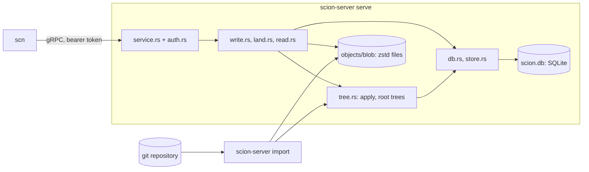
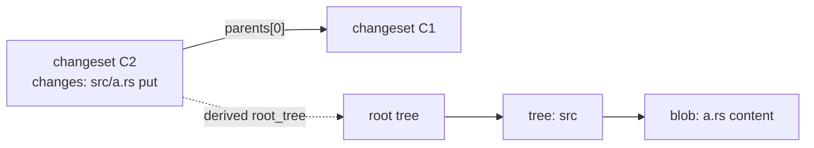
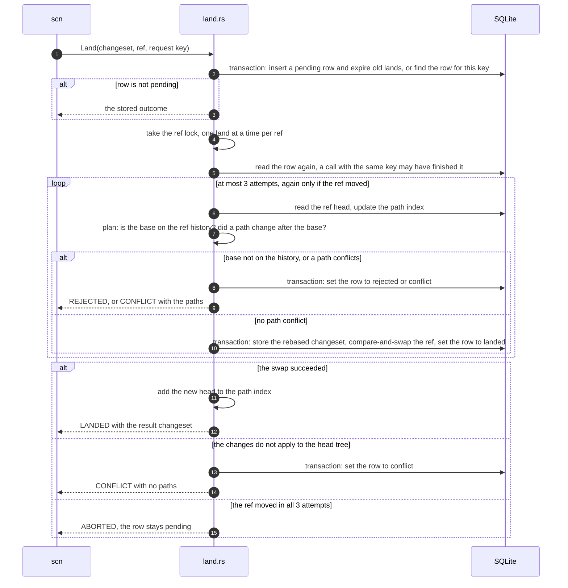
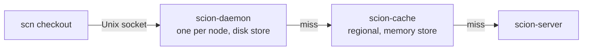

# Architecture

This document explains how open-scion works, for a new contributor who has
read the [README](../README.md). It describes the code on `main`. Parts that do
not exist yet are marked **planned**, with the issue that tracks them.
The design follows Anthropic's article
[Redesigning source control](https://www.anthropic.com/engineering/redesigning-source-control).
The README lists where this project makes its own choices.

## 1. Overview

| Crate | Role |
|---|---|
| [`scion-core`](../crates/scion-core) | Object model (`Changeset`, `Tree`, IDs, `RepoPath`) and the v1 encoder and strict decoder. No I/O. |
| [`scion-proto`](../crates/scion-proto) | gRPC types generated from [`proto/scion.proto`](../proto/scion.proto). Largest message 64 MiB, stream chunk 1 MiB. |
| [`scion-server`](../crates/scion-server) | One binary with two commands: `serve` (the API) and `import` (git import). |
| [`scn`](../crates/scn) | Command-line client: `cat`, `ls`, `log`, `show`, `commit`, `land`, `bench`. |



How one request flows through the server:

1. `auth.rs` checks the bearer token and tags the request with a `Caller`.
2. `service.rs` checks names, IDs and paths, then runs `write.rs`, `land.rs`
   or `read.rs` on a blocking thread (SQLite and the blob folder are
   synchronous). At most 256 run at once. A request times out after 600 s.
3. `error.rs` maps errors to gRPC codes. Database, I/O, git and corruption
   errors reply `INTERNAL`. The detail goes only to the server log.

## 2. Object model

Three kinds of objects. All are content-addressed and never change.

| Object | What it is |
|---|---|
| Blob | The raw bytes of one file, or the target of one symlink. |
| Tree | One directory level: entries sorted by raw name bytes, each a file state or a child tree. |
| Changeset | One commit: parents, author, optional committer, message, and the changed paths. |

**A changeset stores only first-parent deltas.** `parents[0]` is the diff
base. `changes` maps each path that differs from `parents[0]` to a new file
state or to a delete. Other parents, such as the second parent of a merge, are
recorded but not diffed. So a changeset's size grows with the change, not
with the repository. The full snapshot is derived data (section 4).

A file state is a regular file (blob and executable flag), a symlink (blob
that holds the target), or a gitlink (a git commit ID, no blob). Only git
import sets `committer`, creates a changeset with zero or several parents, or
creates a repo or a ref. No RPC creates a repo or a ref, so a new repo starts
with `scion-server import`.



**IDs.** Every ID is BLAKE3 over a domain prefix plus the object's canonical
bytes. Each kind has its own prefix (`scion\0blob\0v1\0`,
`scion\0changeset\0v1\0`, `scion\0tree\0v1\0`), so the same bytes get a
different ID as each kind. `BlobId`, `TreeId` and `ChangesetId` are distinct
Rust types. A blob ID hashes the uncompressed file bytes.

**Generation** is graph metadata, stored next to the changeset and not part of
the hash: 1 for a root, else 1 + the highest parent generation.

**Why the format is frozen.** An ID is a hash of the bytes, so any change to
the encoding changes every ID. The decoder accepts exactly one encoding per
object, so an accepted object re-encodes to the same bytes and the same ID.
Golden tests, property tests and a fuzz target pin this. A change needs a new
format version. [`format-v1.md`](format-v1.md) has the bytes, the path rules
and the decoder rules.

## 3. Storage

One data directory holds everything (`store.rs`):

```text
<data>/lock                    locked by the one process that uses <data>
<data>/scion.db                metadata and trees (SQLite)
<data>/objects/blob/ab/cd..    one zstd file per blob, named by its ID in hex
<data>/tmp/                    staging for atomic blob writes
```

**SQLite tables** ([`migrations/`](../crates/scion-server/migrations)):

| Table | Holds |
|---|---|
| `repos` | Repository name to `repo_id`. |
| `changesets` | ID, generation and `ChangesetV1` bytes. Global: one row per changeset, whatever repos have it. |
| `changeset_parents` | Parent `n` of each changeset, also indexed by parent. |
| `repo_changesets` | Which changesets a repo may read. Every changeset read checks this table. |
| `refs` | Ref name to target and `version`. A ref moves only by compare-and-swap on `version`. A foreign key keeps the target in the repo. |
| `lands` | One row per land request, unique on (repo, caller, request key): state, result, detail, conflict paths, and when it finished. A finished row expires after 7 days (section 5). |
| `trees` | `TreeV1` bytes by tree ID. Global. |
| `derived` | Derived values by (kind, version, changeset). Rebuildable. |
| `git_import` | Git commit ID to changeset, per repo, so a re-import skips known commits. |

Trees live in SQLite, not in the blob folder, so a derivation that writes many
trees commits them in one transaction. The schema version is
`PRAGMA user_version`. When a database opens, each migration in
`migrations/` that is newer than its version runs, in order, in its own
transaction. A released migration never changes. A build refuses a database
with a newer version. All database access goes through one connection behind
a mutex. Write transactions use `BEGIN IMMEDIATE`.

**Blob folder.** One zstd file per blob, at most 100 MiB uncompressed. A write
goes to a temp file in `tmp/`, is flushed, and is renamed into place. A read
unpacks the file and checks its hash. A file that does not match its ID is
corrupt, and the next put of that content replaces it.

**Durability rules.**

- Group commit: concurrent callers share one full drive flush (`F_FULLFSYNC`
  on macOS). Each caller first makes its writes reach the drive with a plain
  `fsync`, then waits for a full flush that starts after that, and one
  waiting caller runs it for all. A failed flush fails every caller that
  waited for it.
- A database transaction is durable when `Store::write` returns, or after a
  later `Store::flush`. WAL with `synchronous = FULL` ends each commit with a
  plain `fsync`. On macOS that can leave the commit in the drive cache, so
  `flush` waits for a shared full flush. SQLite runs no full flush of its own
  (`fullfsync = OFF`), except in checkpoints (`checkpoint_fullfsync`).
  Elsewhere the commit's `fsync` already flushes the cache. A land waits for
  the flush after it releases the ref's lock, so queued lands share it.
- A blob is durable after `BlobBatch::sync`: a plain `fsync` of each blob file
  when written, then of each changed fan-out directory, then a shared full
  flush.
- No committed metadata may name a blob that a crash could lose. `PutBlob`
  syncs its blob before it replies. `CreateChangeset` reads back, hashes and
  syncs every blob it names before its transaction. Git import syncs one blob
  batch per 1,000 commits before the transaction that records them.
- A stored blob still costs a full flush when it is put again or named by a
  changeset: another batch may have written it and not synced yet.

**Data-directory lock.** `Store::open` takes an exclusive, non-blocking
`flock` on `<data>/lock` and holds it until the last `Store` clone is dropped.
Lands are serialized by an in-memory lock (section 5), which a second process
would not see. So `scion-server import` needs the server stopped.

## 4. Derived data

Derived data is computed from changesets and is not part of them. Clients
never see how it is stored, so the server can change it freely. Today there is
one kind, `root_tree` version 1: the root tree of a changeset's full snapshot.

**Computed from the parent.** A changeset's root tree is its first parent's
root tree plus its changes. `tree::store_changeset`, the one write path for
changesets (`CreateChangeset`, `Land`, git import), does this in the caller's
transaction: apply the changes, store the new trees, insert the changeset,
record its `root_tree`.

`tree::apply` runs all deletes before all puts, so one changeset can turn a
file into a directory or back. It loads only the directories on changed paths
and removes directories left empty. It fails on a delete of a missing path or
of a directory, and on a put where a file or a directory is in the way.

**Iterative derivation.** If a `root_tree` row is missing,
`tree::derive_root_tree` walks first parents back to the nearest changeset
that has one, then applies changes forward, oldest first, storing each root
tree. It is a loop, not recursion, so a long chain is safe. A second write of
a value must equal the first, or the store reports corruption. Rows are keyed
by changeset alone, so `root_tree` checks `repo_changesets` first: a cached
tree must not leak to a repo that cannot see the changeset.

**Planned:** blame and path history as a second kind, with a generic
mechanism for dependencies between kinds and backfill
([#12](https://github.com/bnsd55/open-scion/issues/12)).

## 5. The write path

An agent writes in three steps. Only the last one moves a ref.

1. `PutBlob` for each new file, in 1 MiB chunks. Returns the blob ID.
2. `CreateChangeset` with `ChangesetV1` bytes. Returns the changeset ID.
3. `Land` rebases the changeset onto a ref and moves the ref.

All three are safe to repeat. A land retry must reuse its request key.
`GetLand(land_id)` returns the stored state of a land that the same caller
started.

**CreateChangeset** (`write.rs`):

1. Decode strictly, with at most 100,000 changes. A larger change count is
   refused before any change is read.
2. Check the request: exactly one parent, no committer, a message of at most
   1 MiB, author name and email of at most 1 KiB each.
3. Read back every blob it names, outside the database lock.
4. In one write transaction: if the repo already has this ID, return it (a
   retry). The parent must be in the repo. Then `tree::store_changeset`.
   Changes that do not apply to the parent's tree are `INVALID_ARGUMENT`.

**Land** (`land.rs`):



- **Retries by request key.** The caller chooses the key, unique per
  (repo, caller). A retry with the same key finds the same row: a finished
  land returns its outcome, a pending one resumes. The same key with a
  different changeset or ref is `INVALID_ARGUMENT`. `scn land` uses
  `<changeset ID>:<ref>` as the default key.
- **Retention.** A finished land (landed, conflict or rejected) is kept for
  7 days after it finished (`LAND_RETENTION_SECS`). A pending land is kept
  until a retry finishes it. Each new land deletes up to 100 expired lands,
  oldest first, in the transaction that records it. The newest land always
  stays, so a land ID is never given out twice. The upgrade to schema
  version 2 gives older finished lands the time of the upgrade, so their
  7 days start then.
- **A retry after expiry** is a new land with a new ID, and `GetLand` with
  the old ID returns `NOT_FOUND`. It cannot land the changeset twice: the
  landed copy changed every path of the changeset after its base, so the new
  land is a conflict. The exception is a changeset with no changes: it lands
  again as one more empty changeset, and no file changes.
- **The rebase** is the input changeset with its parent replaced by the ref
  head. Changes, author and message stay the same. If the base is already the
  head, the result is the input changeset itself.
- **Crash safety.** The pending row commits before any other work. One
  transaction then stores the rebased changeset and its root tree, moves the
  ref, and marks the row landed. A crash leaves a pending row (a retry
  finishes it) or a landed row (a retry returns it), never a moved ref
  without a landed row. The ref lock is one mutex per (repo, ref), in process.
- **Durable before the reply.** Every reply waits for a full flush that covers
  the land's transactions (`Store::flush`). The land releases the ref lock
  first, so the lands queued behind it share that flush.
- **ABORTED on contention.** Only git import moves a ref without the ref lock.
  The data-directory lock keeps the `import` command and the server apart, so
  this race needs both in one process, as in the tests. If the
  compare-and-swap fails, the transaction rolls back and the land is planned
  again from the new head. After 3 attempts the call fails with `ABORTED` and
  the row stays pending. The caller retries with the same key. `scn land`
  does not retry. Run it again: the default key is the same.
- **Outcomes.** `CONFLICT` and `REJECTED` are land states in a successful
  reply, not gRPC errors. A land to a missing ref is rejected at once. If the
  path check passes but the changes do not apply to the head tree, the land
  is a conflict with no paths.

**The path index.** Each ref slot holds an in-memory `PathIndex` over the
ref's first-parent history, from a `floor` changeset to the `tip`:

- `files`: path to the newest generation that put or deleted it,
- `dirs`: directory to the newest generation that changed anything below it.

It is built on the first land to a ref. It grows forward when the ref moves,
and backward when a land has an older base. If the head does not descend from
the tip, it starts over. After an error other than `ABORTED` it is dropped and
rebuilt, because it may be ahead of the database.

A changed path `p` conflicts when one of these is newer than the base:
`files[p]` (the same path changed), `dirs[p]` (something below `p` changed),
or `files[d]` for a directory `d` above `p` (a file at a parent path changed).

**Why `generation > base_gen` means "changed after the base".** A child's
generation is at least 1 + its first parent's. So generations strictly
increase along a first-parent chain. The index holds only changesets on the
ref's first-parent chain, and a land is rejected unless its base is on that
chain. On such a chain, a changeset comes after the base exactly when its
generation is greater than the base's. So a path changed after the base
exactly when its newest generation in the index is greater than `base_gen`.
The check costs one lookup per path part, not a walk over history. A merge's
changes are its diff against its first parent, so paths that a merge brought
in are indexed at the merge's generation.

```text
gen        10        11          12          13
main:      B ─────── X ───────── Y ───────── H   (head)
                     puts a.rs   puts b/c.rs

land of a.rs, base B   files["a.rs"] = 11 > 10    conflict
land of b,    base B   dirs["b"]     = 12 > 10    conflict
land of d.rs, base B   no entry                   lands on H
```

**Pruning.** The index works in cycles of 10,000 generations of the tip.
During a cycle it notes the oldest base that a land used. When the cycle
ends, the floor moves up to that base, or to the tip at the cycle start if no
base was older. Every entry at or below the new floor is dropped. So memory
follows the oldest base in use, not the time since the server started. A
base that a cycle used stays in the index until the next cycle ends.

**Why pruning cannot hide a conflict.** After a prune, the index still holds,
for each path, the newest generation that changed it after the floor. A
land's base is at or above the floor, or below it:

- At or above the floor: every dropped entry has a generation at or below the
  floor, so at or below `base_gen`. It never counts as newer than the base,
  so the check gives the same answer as before the prune.
- Below the floor: `reach` walks the history in the database from the floor
  back to the base, and adds each changeset it passes. The index then holds
  every change after the base again.

So the choice of the new floor changes only the speed, never the answer.

**Planned:** a lander that rebases a batch of pending lands and moves the ref
once ([#18](https://github.com/bnsd55/open-scion/issues/18)).

## 6. Git import

`scion-server --data DIR import [--repo main] [--rev HEAD] [--ref main] [--verify 100] GIT_DIR`
imports one way, from a local git repository. It needs the server stopped
(the data-directory lock). Only SHA-1 repositories are supported.

**Mapping.**

- Each git commit becomes one changeset. Its parents are the changesets of the
  git parents, in git order. Its changes are the git tree diff against the
  first parent. Subtrees with the same git ID on both sides are skipped.
- Author and committer are kept. The `encoding`, `gpgsig` and `mergetag`
  headers are dropped. Changeset IDs are not git commit IDs.
- Modes `100644`/`100664`, `100755`, `120000` and `160000` become regular,
  executable, symlink and gitlink entries. Any other mode, a path that breaks
  the path rules, or a file over 100 MiB fails the import.

**Order and batches.**

1. Walk every commit reachable from `--rev`, parents first, with an explicit
   stack. Commits already in `git_import` are not imported again.
2. For each batch of 1,000 commits, build the changesets, write new blobs into
   one blob batch, and sync it.
3. In one transaction, store each changeset with `tree::store_changeset`,
   record its `git_import` row, and verify the sampled commits. A failed check
   rolls back the batch. Earlier batches stay, so a rerun continues.
4. Point the ref at the tip.

**Verification.** Every new root and merge commit is checked, plus `--verify`
other new commits, evenly spaced and ending at the newest. A check compares
the Scion root tree with the git tree, entry by entry: names, kinds,
executable flags and content hashes. It also checks that each blob file is
stored intact.

**Forward-only refs.**

| The ref today | Result |
|---|---|
| does not exist | created at the tip |
| is the tip, or already contains it (lands made after an earlier import) | left alone |
| is an ancestor of the tip | moved forward to the tip |
| anything else (diverged) | the import fails, the ref is left alone, the commits stay imported |

## 7. The read path

**Today.** Every read except `ResolveRef` takes a changeset ID, not a ref
name, so its answer is about an immutable object. A client resolves a ref
first. `scn` accepts a
ref name or a 64-digit changeset ID wherever it takes a revision.

| RPC | Answer |
|---|---|
| `ResolveRef` | The changeset a ref points at. The only mutable answer. |
| `GetChangeset` | `ChangesetV1` bytes. |
| `ReadFile` | A regular file's content, or a symlink's target, in 1 MiB chunks. |
| `ListDir` | One directory level as `TreeV1` bytes. |
| `Log` | First-parent history, newest first. At most 1,000 entries and about 32 MiB per reply. A client asks again from the first parent of the last entry. `scn log` makes one call. |

`ReadFile` and `ListDir` get the changeset's root tree from `derived`
(deriving it if the row is missing), then walk trees from SQLite one path part
at a time. `ReadFile` then reads the blob file, unpacks it, checks its hash,
and streams it. Every read checks that the repo has the changeset. `scn`
checks that each changeset it receives hashes to its ID.

**Planned** ([#4](https://github.com/bnsd55/open-scion/issues/4),
[#5](https://github.com/bnsd55/open-scion/issues/5)): an `Objects` service
with three calls:

- `ResolveRef`: mutable, so no tier caches it and every tier forwards it.
- `GetRootTree(changeset)`: cacheable, because a changeset never changes.
- `GetObjects`: streams trees and blobs in their stored form. The client
  checks each one by its hash.

`scn checkout` will walk one tree level per batch, then fetch blobs in
batches, with optional sparse directories.

The article says one `scion-daemon` stores objects for the whole node and is
reached over a socket. It talks only to a regional `scion-cache`, which serves
objects from memory. Every tier answers identical calls, and no tier skips the
next one. The Unix socket, the call names above and access tickets are this
project's choices:



Related planned work: a benchmark against `git clone`
([#6](https://github.com/bnsd55/open-scion/issues/6)), a checkout-safe path
policy ([#7](https://github.com/bnsd55/open-scion/issues/7)), and virtual
checkout, where files load when first read
([#11](https://github.com/bnsd55/open-scion/issues/11)).

## 8. Security model

open-scion is a proof of concept for one trusted machine. Do not expose it to
an untrusted network.

| Area | Today | Limit |
|---|---|---|
| Authentication | One static bearer token (`--token` or `SCION_TOKEN`). The server compares BLAKE3 digests of the tokens in constant time. | Every caller is the same principal, `default`. No users or per-folder rules ([#13](https://github.com/bnsd55/open-scion/issues/13)). |
| Network | Listens on `127.0.0.1:7878` by default. A non-loopback address is refused unless `--insecure-listen` is given. | No TLS: the token and all data travel unencrypted ([#14](https://github.com/bnsd55/open-scion/issues/14)). |
| Repo isolation | Changesets, trees and derived trees are reached only through `repo_changesets`. No RPC takes a tree or blob ID. | Blobs are shared by all repos. A changeset can name another repo's blob by ID and then read it ([#13](https://github.com/bnsd55/open-scion/issues/13)). |
| Lands | `GetLand` and request keys are scoped by caller. | With one principal, all callers share one scope. |
| Input limits | Strict, fuzzed decoder. Messages up to 64 MiB, blobs up to 100 MiB, 16 uploads at once. Names of 1 to 256 bytes with no control characters. | No per-principal quotas ([#15](https://github.com/bnsd55/open-scion/issues/15)). Finished `lands` rows expire after 7 days, pending ones stay (section 5). |
| Errors | Internal errors reply `internal error`. The detail stays in the server log. | |

The planned cache tiers will need access tickets, because an object ID is not
a permission ([#13](https://github.com/bnsd55/open-scion/issues/13)). Report
security problems as described in [SECURITY.md](../SECURITY.md).

## 9. Deliberate shortcuts

Each deliberate simplification is marked `SHORTCUT:` in the code, with its
limit and its upgrade path. This is the list on `main` today.

| File | Shortcut | Upgrade | Issue |
|---|---|---|---|
| `scion-core/src/codec.rs` (`put_len`) | Encoding panics if a field is longer than `u32::MAX`. Every ingest path caps sizes far below that. | `try_encode` returning `Result`, if a path ever does not. | |
| `scion-server/src/store.rs` (`MAX_OBJECT_BYTES`) | An upload is buffered in memory, up to 100 MiB, before it is hashed and written. | Stream to a temp file and hash the chunks. | [#16](https://github.com/bnsd55/open-scion/issues/16) |
| `scion-server/src/store.rs` (`Inner::db`) | One SQLite connection behind a mutex, so reads wait for writes. | A pool of read-only connections. | [#17](https://github.com/bnsd55/open-scion/issues/17) |
| `scion-server/src/store.rs` (`Store::open`) | One process per data directory, so an import needs the server stopped. | Let a separate importer process share the directory. Lands already re-plan when the ref moves (`MAX_ATTEMPTS`). | [#27](https://github.com/bnsd55/open-scion/issues/27) |
| `scion-server/src/store.rs` (`Blobs::verify`) | Holds the packed and the unpacked bytes, up to about 200 MiB per call. | Stream the unpacked bytes into the hasher. | [#20](https://github.com/bnsd55/open-scion/issues/20) |
| `scion-server/src/store.rs` (`Store::flush`) | Between a commit and its full flush, other calls can read the commit, and a power loss can undo what they saw. | Hide commits until their flush, or a lander that batches lands. | [#18](https://github.com/bnsd55/open-scion/issues/18) |
| `scion-server/src/store.rs` (`BlobBatch::keep`) | Keeping a stored blob costs a full flush, because another batch may not have synced it. | Track the blobs written but not yet synced, and flush every blob directory and the drive at open. | [#35](https://github.com/bnsd55/open-scion/issues/35) |
| `scion-server/src/write.rs` (`create_changeset`) | Blobs are shared by all repos. Safe with one principal. | A `repo_blobs` table, checked in `CreateChangeset`. | [#13](https://github.com/bnsd55/open-scion/issues/13) |
| `scion-server/src/land.rs` (`MAX_ATTEMPTS`) | Imports move refs without the land lock, so a land retries 3 times, then returns `ABORTED`. | Route every ref move through the per-ref lander. | [#27](https://github.com/bnsd55/open-scion/issues/27) |
| `scion-server/src/land.rs` (`Lands::land`) | An in-process lock serializes lands per ref, so this works with one server process. | One lander per ref that rebases a batch and moves the ref once. | [#18](https://github.com/bnsd55/open-scion/issues/18) |
| `scion-server/src/land.rs` (`PathIndex`) | Memory follows the oldest base in use. A client that lands on a very old base in every cycle keeps that much history in memory. | Check bases older than a fixed depth with a walk from the database that keeps no entries. | [#36](https://github.com/bnsd55/open-scion/issues/36) |
| `scion-server/src/auth.rs` (`Auth`) | One static token, one principal. | A token-to-principal map, then per-path write rules. | [#13](https://github.com/bnsd55/open-scion/issues/13) |
| `scion-server/src/main.rs` (`serve`) | No TLS. | Tonic TLS or mTLS before any deployment beyond one machine. | [#14](https://github.com/bnsd55/open-scion/issues/14) |
| `scn/src/client.rs` (`lossy`) | Non-UTF-8 names and messages print with replacement characters, also in JSON. | Escape or base64 raw bytes in JSON. | |
| `scn/src/cmd/commit.rs` (`commit`) | Reads each local file whole, so memory caps the file size. | Stream chunks from the file. | |
| `scn/src/cmd/commit.rs` (`commit`) | The author time zone is always UTC. | A time zone crate. | |
