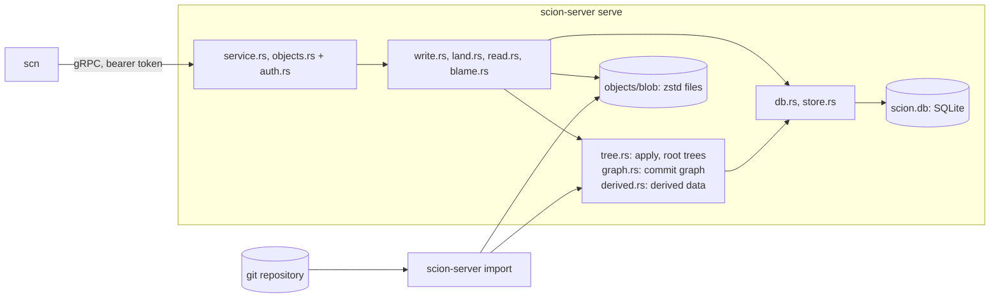
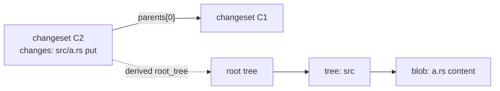
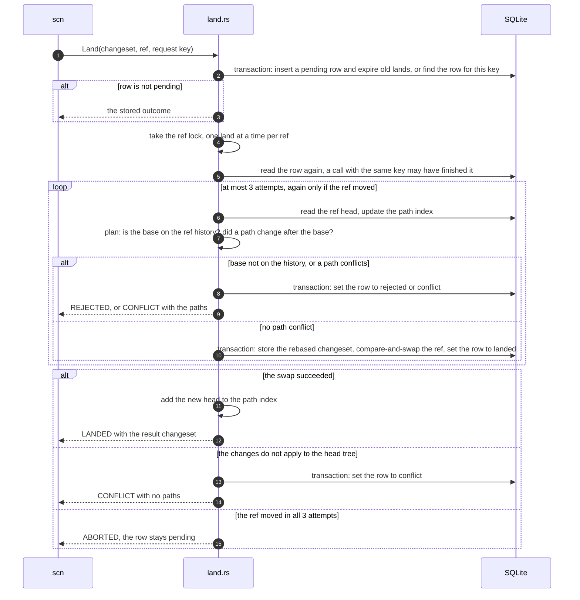
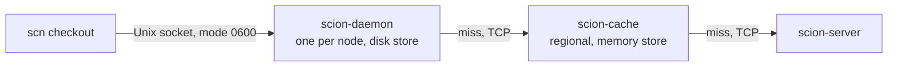

# Architecture

This document explains how open-scion works, for a new contributor who has
read the [README](../README.md). It describes the code on `main`. Parts that do
not exist yet are marked **planned**, with the issue that tracks them.
The design follows Anthropic's article
[Redesigning source control](https://www.anthropic.com/engineering/redesigning-source-control).
The README lists where this project makes its own choices.
[`design/scalable-backend.md`](design/scalable-backend.md) proposes a backend that scales out to many servers (not built).

## 1. Overview

| Crate | Role |
|---|---|
| [`scion-core`](../crates/scion-core) | Object model (`Changeset`, `Tree`, IDs, `RepoPath`) and the v1 encoder and strict decoder. No I/O. |
| [`scion-proto`](../crates/scion-proto) | gRPC types generated from [`proto/scion.proto`](../proto/scion.proto): the `Scion` and `Objects` services, whose contract is [`protocol-v1.md`](protocol-v1.md). Largest message 64 MiB (a `GetObjects` reply message: one object of up to 100 MiB), stream chunk 1 MiB. Also the code that the server and the tiers share: the bearer-token check (`auth.rs`) and the `GetObjects` reply rules (`reply.rs`). |
| [`scion-server`](../crates/scion-server) | One binary with two commands: `serve` (the API) and `import` (git import). |
| [`scion-tier`](../crates/scion-tier) | The cache tiers (section 7): a `Tier` library and two binaries, `scion-cache` (memory) and `scion-daemon` (disk, Unix socket). |
| [`scn`](../crates/scn) | Command-line client: `cat`, `ls`, `log`, `blame`, `show`, `merge-base`, `is-ancestor`, `diff`, `checkout`, `commit`, `land`, `bench`. |



How one request flows through the server:

1. The bearer-token check (`scion-proto/src/auth.rs`) tags the request with
   a `Caller`.
2. `service.rs` (the `Scion` service) or `objects.rs` (the `Objects` service)
   checks names, IDs and paths, then runs `write.rs`, `land.rs`, `read.rs`
   or `blame.rs` on a blocking thread (SQLite and the blob folder are
   synchronous). Both services share one bound: at most 256 run at once,
   and at most 4 of them are `Blame` calls. A
   request times out after 600 s; for a streamed reply that covers only its
   start. A `GetObjects` reply ends when its client takes no object for
   120 s, and a `ReadFile` reply when its client takes no part for 120 s.
   A timeout, or a client that cancels,
   drops the call but not a job that is already running. So a land checks
   a deadline in its long loops (the index advance and the walks back to a
   base): 600 s after the call started, or as soon as a guard that the call
   holds has dropped. Then the land stops and stays pending, and the client
   sees `CANCELLED` or `DEADLINE_EXCEEDED`.
3. `error.rs` maps errors to gRPC codes. Database, I/O, git and corruption
   errors reply `INTERNAL`. The detail goes only to the server log.

## 2. Object model

Three kinds of objects. All are content-addressed and never change.

| Object | What it is |
|---|---|
| Blob | The raw bytes of one file, or the target of one symlink. |
| Tree | One directory level: entries sorted by raw name bytes, each a file state or a child tree. |
| Changeset | One commit: parents, author, optional committer, message, and the changed paths. |

**A changeset stores only first-parent deltas.** `parents[0]` is the diff
base. `changes` maps each path that differs from `parents[0]` to a new file
state or to a delete. Other parents, such as the second parent of a merge, are
recorded but not diffed. So a changeset's size grows with the change, not
with the repository. The full snapshot is derived data (section 4).

A file state is a regular file (blob and executable flag), a symlink (blob
that holds the target), or a gitlink (a git commit ID, no blob). Only git
import sets `committer`, creates a changeset with zero or several parents, or
creates a repo or a ref. No RPC creates a repo or a ref, so a new repo starts
with `scion-server import`.



**IDs.** Every ID is BLAKE3 over a domain prefix plus the object's canonical
bytes. Each kind has its own prefix (`scion\0blob\0v1\0`,
`scion\0changeset\0v1\0`, `scion\0tree\0v1\0`), so the same bytes get a
different ID as each kind. `BlobId`, `TreeId` and `ChangesetId` are distinct
Rust types. A blob ID hashes the uncompressed file bytes.

**Generation** is graph metadata, stored next to the changeset and not part of
the hash: 1 for a root, else 1 + the highest parent generation.

**Why the format is frozen.** An ID is a hash of the bytes, so any change to
the encoding changes every ID. The decoder accepts exactly one encoding per
object, so an accepted object re-encodes to the same bytes and the same ID.
Golden tests, property tests and a fuzz target pin this. A change needs a new
format version. [`format-v1.md`](format-v1.md) has the bytes, the path rules
and the decoder rules.

## 3. Storage

One data directory holds everything (`store.rs`):

```text
<data>/lock                    shared by every process that uses <data>
<data>/open.lock               held while a process opens <data>
<data>/server.lock             held by the one server process
<data>/scion.db                metadata and trees (SQLite)
<data>/objects/blob/ab/cd..    one zstd file per blob, named by its ID in hex
<data>/tmp/                    staging for atomic blob writes and uploads
```

**SQLite tables** ([`migrations/`](../crates/scion-server/migrations)):

| Table | Holds |
|---|---|
| `repos` | Repository name to `repo_id`. |
| `changesets` | ID, generation and `ChangesetV1` bytes. Global: one row per changeset, whatever repos have it. |
| `changeset_parents` | Parent `n` of each changeset, also indexed by parent. |
| `repo_changesets` | Which changesets a repo may read. Every changeset read checks this table. |
| `refs` | Ref name to target and `version`. A ref moves only by compare-and-swap on `version`. A foreign key keeps the target in the repo. |
| `lands` | One row per land request, unique on (repo, caller, request key): state, result, detail, conflict paths, and when it finished. A finished row expires after 7 days (section 5). |
| `trees` | `TreeV1` bytes by tree ID. Global. |
| `derived` | Derived values by (kind, version, changeset), as bytes that each kind encodes. Rebuildable (section 4). |
| `git_import` | Git commit ID to changeset, per repo, so a re-import skips known commits. |

Trees live in SQLite, not in the blob folder, so a derivation that writes many
trees commits them in one transaction. The schema version is
`PRAGMA user_version`. When a database opens, each migration in
`migrations/` that is newer than its version runs, in order, in its own
transaction. A released migration never changes. A build refuses a database
with a newer version. Version 3 lets a derived value have any length; the
upgrade copies every row. All database access of a process goes through one
connection behind a mutex. Write transactions use `BEGIN IMMEDIATE`.

**Blob folder.** One zstd file per blob, at most 100 MiB uncompressed. A write
goes to a temp file in `tmp/`, is flushed, and is renamed into place. The zstd
frame header holds the uncompressed size, so `Blobs::size` reads only the
header. A read unpacks the file and checks its hash. A check that does not
need the content (`Blobs::verify`, used by puts, `CreateChangeset` and
import) streams the file through the decoder into the hasher, so it holds the
zstd window and small buffers, not the whole blob. A file that does not match
its ID, or that unpacks to more than 100 MiB, is corrupt, and the next put of
that content replaces it.

**Uploads.** `PutBlob` streams (`Blobs::upload`). Each message goes into the
hasher and to a spool file in `tmp/` before the server reads the next one, so
an upload holds one message in memory, not the whole blob. The spool file
holds raw bytes, because the frame header needs the size before the first
compressed byte. After the last message, the server keeps an intact stored
copy if there is one. Otherwise it streams the spool file through the
compressor into the temp file. The spool file has no name, so a dropped
upload or a crash leaves nothing behind. An open that finds no other process
in the data directory removes any temp file that a crash left before its
rename (see below).

**Durability rules.**

- Group commit: concurrent callers share one full drive flush (`F_FULLFSYNC`
  on macOS). Each caller first makes its writes reach the drive with a plain
  `fsync`, then waits for a full flush that starts after that, and one
  waiting caller runs it for all. A failed flush fails every caller that
  waited for it.
- A database transaction is durable when `Store::write` returns, or after a
  later `Store::flush`. WAL with `synchronous = FULL` ends each commit with a
  plain `fsync`. On macOS that can leave the commit in the drive cache, so
  `flush` waits for a shared full flush. In the server, SQLite runs no full
  flush of its own (`fullfsync = OFF`), except in checkpoints
  (`checkpoint_fullfsync`). An import process is different (below).
  Elsewhere the commit's `fsync` already flushes the cache. A land waits for
  the flush after it releases the ref's lock, so queued lands share it.
- A read waits too. If `Store::read` saw a commit that no full flush covers
  yet, it waits for one after it releases the database lock. So no reply
  shows a commit that a power loss can undo, such as a ref target from
  `ResolveRef` or a land state from `GetLand`. Where `fsync` already flushes
  the drive cache, no read waits. A land reads with `Store::read_unflushed`,
  because it flushes before it replies.
- A read that derives a value, such as the root tree for `GetRootTree`,
  waits for a full flush of that derivation before it replies (section 4).
  So a client never gets a tree ID that a power loss can undo.
- A blob is durable after `BlobBatch::sync`: a plain `fsync` of each blob file
  when written, then of each changed fan-out directory, then a shared full
  flush.
- No committed metadata may name a blob that a crash could lose. `PutBlob`
  syncs its blob before it replies. `CreateChangeset` reads back, hashes and
  syncs every blob it names before its transaction. Git import syncs one blob
  batch per 1,000 commits before the transaction that records them.
- A stored blob still costs a full flush when it is put again or named by a
  changeset: another batch may have written it and not synced yet.

**Processes that share a data directory.** `scion-server import` can run
while the server runs. The server opens the directory with `Store::open`, an
import with `Store::open_shared`. Each holds its `flock`s until the last
`Store` clone is dropped:

| Lock file | Held by |
|---|---|
| `<data>/server.lock` | The server, exclusive. Lands are serialized in its memory (section 5), so a second server is refused. `derive` opens as the server too: it removes rows of older versions of a kind, which a running server of an older build may still read. |
| `<data>/lock` | Every process, shared, for its whole life. An open first tries to take it exclusive, to learn whether another process uses the directory. An older build holds it exclusive for its whole life, so it and this build keep each other out. The file holds the build of the processes that use the directory (below). |
| `<data>/open.lock` | A process while it opens the directory, so opens take turns. |

- **Alone at open.** Only a process that opens the directory alone removes
  the files in `tmp/` and runs schema migrations. While another process runs,
  its temp files are live, and its statements need the schema it knows. So
  the temp files that a crashed import leaves stay until an open finds the
  directory unused ([#101](https://github.com/bnsd55/open-scion/issues/101)).
  A shared open of an older schema fails: stop the other processes to
  upgrade it.
- **One build.** Each process removes the derived rows of older versions of
  a kind (section 4), which a process of an older build may still read. So
  the first process writes its build into `<data>/lock`: the schema version
  and the version of each kind (`store::build`). An open while other
  processes run fails unless its build is the same.
- **Writes take turns.** SQLite in WAL mode lets one process read while the
  other writes. A write waits for the write transaction of the other
  process, up to `busy_timeout` (5 s), and then fails with `UNAVAILABLE`, so
  the client retries. An import holds the
  write lock for one batch of 1,000 commits, verification included. While a
  server write waits, it holds the server's one connection, so the server's
  reads wait too ([#100](https://github.com/bnsd55/open-scion/issues/100)).
- **Refs.** Both processes move a ref by compare-and-swap on its `version`,
  each in a write transaction. The server sees a move that the import made at
  its next land on the ref: each plan reads the head from the database and
  advances the path index to it (section 5).
- **Durability.** Each process counts and flushes its own commits, and group
  commit shares a full flush only within one process. A server reply that
  only reads does not flush for a commit of another process. So a shared
  `Store` commits with `fullfsync = ON`: SQLite syncs the log with a full
  flush of the drive cache before the commit becomes visible. The server
  never sees an import commit that a power loss can undo. In turn, a server
  commit reaches the drive before the import can see it. So the import runs
  a full flush before it reports, which covers every write that reached the
  drive. Its report rests on no server commit that a power loss can undo.
- **Blobs.** The import syncs each blob batch before the transaction that
  names its blobs, as in one process. So a blob that the server reaches
  through metadata is durable. The server reads blob files directly, and
  checks each against its ID.

## 4. Derived data

Derived data is computed from changesets and is not part of them.

**What the article says.** Everything that is not part of a changeset is
derived data, and one generic mechanism computes all of it. Each kind is
defined recursively: its value for a changeset is computed from its values
for that changeset's parents. For each kind, the server chooses to compute it
eagerly or to defer the work. Clients never see these structures, so the
server can change them without a client change.

**How this project does it** (`derived.rs`). Only two ideas in this table
come from the article: a value comes from the parents' values, and a kind is
computed eagerly or on demand. The rest is this project's choice.

| Part | Here |
|---|---|
| A kind | `derived::Kind`: a name, a version, and `derive`, a function from a changeset and its parents' values, in parent order, to a value. Each kind encodes its value as bytes. |
| Inputs | By default the first parent's value only, and only first-parent history is derived: a changeset stores only its changes against its first parent (section 2), so a kind over snapshots needs no more. A kind with `ALL_PARENTS`, such as `commit_graph` (below), gets the value of every parent, and every ancestor is derived. `derive` may also read the stored value of an older changeset that it reaches through those parents. |
| On demand | `derived::get` reads the stored value. If there is none, `derived::fill` derives it in steps (below). |
| Steps | `fill` walks from the changeset through the parents that the kind reads, and stops at each changeset with a stored value. It visits at most `derived::STEP` (100) changesets per hold of the database lock. It keeps the changesets without a value, 40 bytes each with the generation, so it visits each one once. A walk over every parent also keeps the set of changesets it visited. Then it derives them in generation order, oldest first, at most `STEP` changesets per transaction, and commits each one. A parent's generation is below its child's, so each changeset comes after its parents. Other requests run between steps. A step reads a value that is already stored, for example by a concurrent `fill`, and does not derive it again. So a changeset has a value only if each parent that its kind reads has one, back to the roots. |
| Eager | A kind can also store its value when the changeset is written. `root_tree` does (below). `commit_graph` does if each parent has a value (`derived::on_write`), so a write never derives a long history. |
| Storage | One `derived` row per (kind, version, changeset), written in the transaction that derives it. A large structure belongs in its own table, and the value is its ID, as `root_tree` keeps trees in `trees`. |
| A version bump | A new version reads and writes only its own rows. So the old rows become unused, and nothing rewrites them. The new version derives its values again, in steps. Each step, and each write of a root tree, also deletes up to `STEP` rows of older versions of its kind, as each new land deletes a few expired lands. Rows of a newer version stay: a newer build that ran on this data may run again, and it reads them. Rows of a kind that the build no longer has also stay. |
| Backfill | `derived::backfill`, and `scion-server derive --kind root_tree --ref main` (with the server stopped: it opens the data directory as the server), fill a ref's history in steps (`--kind commit_graph` fills every ancestor), then delete every row of an older version, `STEP` rows per transaction. It is safe to repeat. |
| Repos | Rows are keyed by changeset alone. A changeset ID fixes its whole history, so a value is the same in every repo. `get`, `fill` and `derive` check `repo_changesets` first, so a stored value never leaks to a repo that cannot see the changeset. |
| Durability | A value can name rows that its derivation wrote, such as trees, and a reply can send it to a client. So when `get` derives a value, it waits for one full flush after the last step, shared with concurrent commits, before it returns. It waits on an error too. `fill`, `derive` and `put` never flush: inside a write, the write's own flush covers them. |
| Crashes | Each step commits on its own, and values never change. So a crash or an error between steps leaves only correct rows. The next read walks back to the stored values and goes on from there. |
| One answer | A second write of a value must equal the first, or the store reports corruption. |

**Cost of a new kind or version.** The first read of a tip with a long history
still derives the whole history before it replies, so that read waits. Other
requests wait for at most one step at a time. A backfill before the server
starts removes that wait.

**Root trees.** Kind `root_tree` version 1 (`tree::RootTree`): the root tree
of a changeset's full snapshot, as a 32-byte tree ID. It is the first
parent's root tree plus the changeset's changes. It is eager.
`tree::store_changeset`, the one write path for changesets (`CreateChangeset`,
`Land`, git import), does this in the caller's transaction: apply the
changes, store the new trees, insert the changeset, record its `root_tree`.
If the row is missing, `tree::root_tree` derives it on demand. A golden test
pins the tree IDs of a fixed history, both when they are stored at write time
and when they are derived on demand.

The write needs the first parent's root tree in its transaction. After a
version bump of `root_tree`, that parent has no row, and the transaction
would derive its whole history. So `CreateChangeset` and `Land` call
`tree::fill_root_tree` on the parent before the transaction, and the
transaction then finds the parent's row. Git import does the same for each
first parent from before its batch: a server that shares the data directory
waits for the batch's transaction (section 3).

`tree::apply` runs all deletes before all puts, so one changeset can turn a
file into a directory or back. It loads only the directories on changed paths
and removes directories left empty. It fails on a delete of a missing path or
of a directory, and on a put where a file or a directory is in the way.

**Commit graph.** Kind `commit_graph` version 1 (`graph::CommitGraph`). The
article says that Scion keeps skip lists for the commit graph as derived
data. The form of the skip list here is this project's choice: the
skew-binary jump pointers of Myers ("An applicative random-access stack",
1983). Each changeset gets a node of 112 bytes, or 160 with a merge:

- its generation, and its first-parent depth (0 for a root),
- its first parent, and one jump to an older changeset on its first-parent
  history. If the parent's jump and the jump after it span the same depth,
  the jump goes over both, else to the parent. So the depth that a jump
  lands on depends only on the depth it starts from,
- the newest changeset with two or more parents on its first-parent history,
  itself included.

Each link holds the changeset ID, its generation and its depth, so a walk
decides where to go before it reads the next node. A walk down a
first-parent history to a generation or a depth takes the jump unless the
jump goes past the target, and reads O(log n) nodes (Myers). So does the
search for where two first-parent histories meet: from the same depth, the
two jumps land on the same depth, and they land on two changesets exactly
while that depth is above the meeting point. The kind reads every parent, so
each ancestor of a changeset with a node has one, and the queries can follow
any parent (section 7). The node is stored when a changeset is written, if
each parent has one. In a database from before the commit graph, the first
query derives it in steps.

**Path history and blame are not derived data yet.** The article says
Scion builds dedicated structures for file blame and path history from the
changesets, through the same mechanism. Here both are computed on each call
from first-parent changes, with a bound per call (section 7). That is this
project's choice for now. **Planned:** both as kinds on this mechanism
([#61](https://github.com/bnsd55/open-scion/issues/61)). A unit test shows
that a kind with another value type, which is derived only on demand, works
the same way.

## 5. The write path

An agent writes in three steps. Only the last one moves a ref.

1. `PutBlob` for each new file, in 1 MiB chunks. Returns the blob ID.
2. `CreateChangeset` with `ChangesetV1` bytes. Returns the changeset ID.
3. `Land` rebases the changeset onto a ref and moves the ref.

All three are safe to repeat. A land retry must reuse its request key.
`GetLand(land_id)` returns the stored state of a land that the same caller
started.

**CreateChangeset** (`write.rs`):

1. Decode strictly, with at most 100,000 changes. A larger change count is
   refused before any change is read.
2. Check the request: exactly one parent, no committer, a message of at most
   1 MiB, author name and email of at most 1 KiB each.
3. Check that the repo exists and has the parent, so a bad request reads no
   blob.
4. Read back each blob it names, outside the database lock. A blob that many
   paths name is read once. The error names the first path, in path order,
   whose blob is missing or corrupt.
5. In one write transaction: check the repo and the parent again. If the repo
   already has this ID, return it (a retry). Then `tree::store_changeset`.
   Changes that do not apply to the parent's tree are `INVALID_ARGUMENT`.

**Land** (`land.rs`):



- **Retries by request key.** The caller chooses the key, unique per
  (repo, caller). A retry with the same key finds the same row: a finished
  land returns its outcome, a pending one resumes. The same key with a
  different changeset or ref is `INVALID_ARGUMENT`. `scn land` uses
  `<changeset ID>:<ref>` as the default key.
- **Retention.** A finished land (landed, conflict or rejected) is kept for
  7 days after it finished (`LAND_RETENTION_SECS`). A pending land is kept
  until a retry finishes it. Each new land deletes up to 100 expired lands,
  oldest first, in the transaction that records it. The newest land always
  stays, so a land ID is never given out twice. The upgrade to schema
  version 2 gives older finished lands the time of the upgrade, so their
  7 days start then.
- **A retry after expiry** is a new land with a new ID, and `GetLand` with
  the old ID returns `NOT_FOUND`. It cannot land the changeset twice: the
  landed copy changed every path of the changeset after its base, so the new
  land is a conflict. The exception is a changeset with no changes: it lands
  again as one more empty changeset, and no file changes.
- **The rebase** is the input changeset with its parent replaced by the ref
  head. Changes, author and message stay the same. If the base is already the
  head, the result is the input changeset itself.
- **Crash safety.** The pending row commits before any other work. One
  transaction then stores the rebased changeset and its root tree, moves the
  ref, and marks the row landed. A crash leaves a pending row (a retry
  finishes it) or a landed row (a retry returns it), never a moved ref
  without a landed row. The ref lock is one mutex per (repo, ref), in process.
- **Durable before the reply.** Every reply waits for a full flush that covers
  the land's transactions (`Store::flush`). The land releases the ref lock
  first, so the lands queued behind it share that flush.
- **ABORTED on contention.** Only git import moves a ref without the ref lock,
  in the server's process or in an import process beside it (section 3). It
  moves the ref once, at its end, by compare-and-swap. If the land's
  compare-and-swap fails, the transaction rolls back and the land is planned
  again from the new head. After 3 attempts the call fails with `ABORTED` and
  the row stays pending. The caller retries with the same key. `scn land`
  does not retry. Run it again: the default key is the same.
- **Outcomes.** `CONFLICT` and `REJECTED` are land states in a successful
  reply, not gRPC errors. A land to a missing ref is rejected at once. If the
  path check passes but the changes do not apply to the head tree, the land
  is a conflict with no paths.

**The path index.** Each ref slot holds an in-memory `PathIndex` over the
ref's first-parent history, from a `floor` changeset to the `tip`:

- `files`: path to the newest generation that put or deleted it,
- `dirs`: directory to the newest generation that changed anything below it.

It is built on the first land to a ref, and again after the size budget
dropped it. It grows forward when the ref moves, and backward when a land
has an older base, down to `MAX_DEPTH` (one cycle, 10,000) generations below
the tip. If the head does not descend from the tip, it starts over. After an
error other than `ABORTED` or `DEADLINE_EXCEEDED` it is dropped and rebuilt,
because it may be ahead of the database. A deadline leaves it whole: an
advance adds nothing until it reaches the tip, and a `reach` adds one
changeset at a time, so a retry goes on from there.

A changed path `p` conflicts when one of these is newer than the base:
`files[p]` (the same path changed), `dirs[p]` (something below `p` changed),
or `files[d]` for a directory `d` above `p` (a file at a parent path changed).

**Why `generation > base_gen` means "changed after the base".** A child's
generation is at least 1 + its first parent's. So generations strictly
increase along a first-parent chain. The index holds only changesets on the
ref's first-parent chain, and a land is rejected unless its base is on that
chain. On such a chain, a changeset comes after the base exactly when its
generation is greater than the base's. So a path changed after the base
exactly when its newest generation in the index is greater than `base_gen`.
The check costs one lookup per path part, not a walk over history. A merge's
changes are its diff against its first parent, so paths that a merge brought
in are indexed at the merge's generation.

```text
gen        10        11          12          13
main:      B ─────── X ───────── Y ───────── H   (head)
                     puts a.rs   puts b/c.rs

land of a.rs, base B   files["a.rs"] = 11 > 10    conflict
land of b,    base B   dirs["b"]     = 12 > 10    conflict
land of d.rs, base B   no entry                   lands on H
```

**Pruning.** The index works in cycles of 10,000 generations of the tip.
During a cycle it notes the oldest base that a land used. When the cycle
ends, the floor moves up to that base, or to the tip at the cycle start if no
base was older. Every entry at or below the new floor is dropped. So memory
follows the oldest base in use, not the time since the server started. A
base that a cycle used stays in the index until the next cycle ends.

A base more than `MAX_DEPTH` generations below the tip is not added to the
index and does not count as used. So however old the bases are, they keep
at most about three cycles of history in the index. Such a base is rare: a
client lands soon after it reads the head.

**Size budget.** Pruning bounds the generations, not the paths: one cycle of
changesets with many paths each could fill memory. So the indexes of all refs
share one budget of 128 MiB (`MAX_INDEX_BYTES`), about 1M entries of short
paths. An entry costs its path plus 64 bytes. One atomic counter in `Lands`
holds the sum of all indexes. An index gives its bytes back when it is
pruned, starts over or is dropped. Every addition takes its exact cost from
the counter before it is made (`Lands::reserve`): the keys that the index does
not hold yet, each once (`PathIndex::cost`).

- If too few bytes are free, the indexes of other refs are dropped, least
  recently landed on first, until the addition fits. An index whose ref lock
  is held is in use, so it stays. If dropping all the others that are not in
  use would not free enough, none is dropped. A dropped index gives its bytes
  back at once, and a land frees its memory after it releases the database
  lock and the ref lock. It is built again at the head on the next land to
  its ref. A concurrent land can take the freed room first, so a reservation
  drops indexes at most twice.
- The least-recently-used list holds only the refs that have an index or
  that a land uses. A reservation that drops indexes first removes the
  others, so it looks only at refs with an index.
- If the addition still does not fit, an advance or a land moves the floor
  up to the tip: the index starts over, empty, at the head. So does an
  advance of more than `MAX_DEPTH` changesets, so it never holds the
  database lock for a long walk.
- A `reach` back to an older base stops at the first changeset that does not
  fit. That changeset is the floor, and the walk below checks the rest.

So all indexes together never hold more than the budget, however many refs
take lands. The index of a ref that no longer takes lands goes when another
ref needs the room.

**Why pruning cannot hide a conflict.** After a prune, the index still holds,
for each path, the newest generation that changed it after the floor. A
land's base is at or above the floor, or below it:

- At or above the floor: every dropped entry has a generation at or below the
  floor, so at or below `base_gen`. It never counts as newer than the base,
  so the check gives the same answer as before the prune.
- Below the floor, at most `MAX_DEPTH` below the tip: `reach` walks the
  history in the database from the floor back to the base, and adds each
  changeset it passes. The index then holds every change after the base
  again. If the budget stops `reach` first, the walk of the next case checks
  the rest, from the new floor.
- Below the floor and deeper: the same walk runs, but adds nothing to the
  index. It keeps only what the three conflict rules read for the land's own
  paths. The index holds the changes after the floor, and the walk sees the
  changes from the floor back to the base. A path changed after the base
  exactly when one of the two says so, so the answer is the same as with one
  index. Memory follows the size of the land, not the depth of the base.

A dropped index, or one that started over, is an index whose floor is the
head, so a land on an older base is the second or third case. So the choice
of the new floor, of `MAX_DEPTH` and of the budget changes only the speed,
never the answer. One limit does change it: the walk takes at most 100,000
changesets (`MAX_WALK`). It holds the database lock, so a base further back
is `REJECTED` as too old, and the client must rebase onto a newer head.
Per-path history in the database will remove the walk
([#38](https://github.com/bnsd55/open-scion/issues/38)).

**Not planned now:** a lander that rebases a batch of pending lands and moves
the ref once ([#18](https://github.com/bnsd55/open-scion/issues/18), closed: one
machine already gives about 200 durable lands/s). The
[scalable backend design](design/scalable-backend.md) says when it would be
needed.

## 6. Git import

`scion-server --data DIR import [--repo main] [--rev HEAD] [--ref main] [--verify 100] GIT_DIR`
imports one way, from a local git repository. It can run while the server
runs (section 3). Only SHA-1 repositories are supported.

**Mapping.**

- Each git commit becomes one changeset. Its parents are the changesets of the
  git parents, in git order. Its changes are the git tree diff against the
  first parent. Subtrees with the same git ID on both sides are skipped.
- Author and committer are kept. The `encoding`, `gpgsig` and `mergetag`
  headers are dropped. Changeset IDs are not git commit IDs.
- Modes `100644`/`100664`, `100755`, `120000` and `160000` become regular,
  executable, symlink and gitlink entries. Any other mode, a path that breaks
  the path rules, or a file over 100 MiB fails the import.

**Order and batches.**

1. Walk every commit reachable from `--rev`, parents first, with an explicit
   stack. Commits already in `git_import` are not imported again.
2. For each batch of 1,000 commits, build the changesets, write new blobs into
   one blob batch, and sync it.
3. Derive the missing root tree of each first parent from before the batch,
   in steps, as after a version bump. Then, in one transaction, store each
   changeset with `tree::store_changeset`
   (with its root tree, and its commit-graph node if each parent has one),
   record its `git_import` row, and verify the sampled commits. A failed check
   rolls back the batch. Earlier batches stay, so a rerun continues.
4. Point the ref at the tip. The checks in the table below run in reads,
   and the move is a compare-and-swap on the ref's `version`. If a land moved
   the ref in between, the import checks it again.

**Verification.** Every new root and merge commit is checked, plus `--verify`
other new commits, evenly spaced and ending at the newest. A check compares
the Scion root tree with the git tree, entry by entry: names, kinds,
executable flags and content hashes. It also checks that each blob file is
stored intact.

**Forward-only refs.**

| The ref today | Result |
|---|---|
| does not exist | created at the tip |
| is the tip, or already contains it (lands made after an earlier import) | left alone |
| is an ancestor of the tip | moved forward to the tip |
| anything else (diverged) | the import fails, the ref is left alone, the commits stay imported |

## 7. The read path

Every read except `ResolveRef` names an immutable object (a changeset, tree
or blob ID), never a ref, so any cache tier can answer it. A client resolves
a ref first. `scn` accepts a ref name or a 64-digit changeset ID wherever it
takes a revision, and resolves refs through `Objects`.

**Path reads (`Scion` service).**

| RPC | Answer |
|---|---|
| `ResolveRef` | The changeset a ref points at. The only mutable answer. |
| `GetChangeset` | `ChangesetV1` bytes. |
| `ReadFile` | A regular file's content, or a symlink's target, in 1 MiB chunks. |
| `ListDir` | One directory level as `TreeV1` bytes. |
| `Log` | First-parent history, newest first. With a path, only the changesets that change it. A reply holds at most 1,000 entries and about 32 MiB, and checks at most 1,000 changesets. `next_changeset_id` says where to continue. `scn log` asks again until it has `-n` entries. |
| `Blame` | For each range of lines in a file, the changeset that last changed it on first-parent history, across renames, and that changeset's author, time and path of the file. |
| `MergeBase` | The best common ancestors of two changesets, over all parents. |
| `IsAncestor` | Whether one changeset is an ancestor of another, over all parents. |
| `Diff` | The paths whose file differs between two changesets' snapshots, with the old and new file state. At most 1,000 paths per reply. `next_after` says where to continue. |

**Path history** (`Log` with a path, `read::log_page`). The walk follows
first parents from the given changeset, newest first. It returns each
changeset that changes the path: the file itself, or anything below it if it
is a directory. A changeset lists every file it changes against its first
parent, so the check reads no trees. A commit on a merged branch never
appears; the merge appears when its diff against its first parent changes
the path. The article stores changes against the first parent because people
care about history and blame only for commits on the main line.

**Blame** (`blame.rs`). The article does not describe how blame is
computed. These steps, the diff and the bounds below are this project's
choices. For a file at a changeset:

1. Read the file. A directory, a symlink, a submodule, or a file over 16 MiB
   (`MAX_BLAME_BYTES`) or 1,048,576 lines (`MAX_BLAME_LINES`) is
   `INVALID_ARGUMENT`. A binary file is blamed line by line, as `git blame`
   does: git decides that a file is binary only to show diffs, and `git
   blame` diffs it as text all the same.
2. Walk first parents to the next changeset C that changes the path. The
   older version is the file at the path in C's first parent. If no file is
   there (nothing, or a directory), it is the file that C renamed to the path,
   if any (below). Diff the older version with C's version, line by line. The
   lines that C added go to C. The other lines move to their place in the
   older version, at its path.
3. Repeat from C's first parent until every line has a changeset. If there is
   no older version, or it is over a limit of step 1, every line left goes
   to C. So a file deleted and added again starts over, as in git.

**Renames.** Blame follows a rename, as `git blame` does by default. Where C
adds the path, the source is one of the files that C deletes:

1. A file with the same blob ID. This reads no file. On a tie, a file with
   the same name (the last part of the path) wins, then the first by path.
2. Else, if exactly one deleted file has the same name: that file, if it is
   at least 75% similar.
3. Else, if C deletes at most 100 files (`MAX_RENAME_SOURCES`): the most
   similar file, if it is at least 50% similar. On a tie, a file with the
   same name wins, then the first by path.

Similarity is git's. Each file is cut into chunks that end after a newline or
after 64 bytes. In text (no NUL byte in the first 8,000 bytes, git's test for
binary), a CR before a newline does not count. Similarity is the
bytes of the chunks that both files have, over the size of the larger file.
A file less than half the size of the other is not read. A symlink or a
submodule that becomes a regular file is a type change, not a rename, as in
git. Each changeset that a range names comes with the path of the file there.
`Log` with a path does not follow renames, as `git log` without `--follow`.

Where rename following differs from `git blame`:

- git compares every deleted file. Here a changeset that deletes more than
  100 files gets only steps 1 and 2
  ([#87](https://github.com/bnsd55/open-scion/issues/87)).
- git puts each chunk in one of about 100,000 hash buckets, so two different
  chunks can count as the same. Here chunks compare byte for byte.
- A deleted file over a limit of step 1 is never similar here, and one
  search reads files, in path order, only until it has read about 100 MiB
  (`MAX_RENAME_BYTES`: 100 files of the old 1 MiB limit, so it still reads
  every file that it read under that limit). git can pick any of them
  ([#87](https://github.com/bnsd55/open-scion/issues/87)).
- git also treats a file as binary, so a CR counts, when `.gitattributes`
  marks it `binary` or `-diff`. Here only the NUL byte test counts.
- git checks only a few of many files with the same content, and keeps only
  the four best similar files while it compares. So on a tie among many
  files it can pick another one.
- Neither finds copies or moved lines by default (`git blame -C`, `-M`).
  Here there is no option for them.

The diff is Myers with an indent heuristic, from `gix` (`gix::diff::blob`),
already a dependency for the import. `git blame` also uses Myers by default.
Where several minimal diffs exist, for example around repeated lines, the
two can place a line differently, so the blame can differ from git there.
Tests compare the result with `git blame --first-parent`, line by line, on
histories where they agree: edits, merges, a file that becomes a directory
and a file again, and renames for each rule above.

**Bounds and resume.** A `Log` or `Blame` call checks at most 1,000
changesets (`MAX_SCAN`), so it holds the database lock no longer than a plain
`Log` of 1,000 entries. A `Blame` call also diffs at most 100 versions, and
about 1M lines (`MAX_BLAME_DIFF_LINES`, both sides of each diff). Every byte
that blame reads counts against this budget, once per 64 bytes: a diffed
line counts once per 64 bytes, a rename search counts each chunk it
compares, and a file read and then refused for its lines counts its size. A
version with the same content as the newer one (a mode change, or a rename
with no edit) is not read and costs nothing. The first step of a call always
runs, so a call always makes progress.

So a call reads about 64 MiB in the steps that fit in its budget, plus two
steps past it: the first, which always runs, and the one that stops the call,
which is read and then dropped. One step reads one older version of at most
16 MiB, or one rename search: the size of at most 100 deleted files, and
their content until it has read about 100 MiB, plus the file that crosses
that bound. So one call reads at most about 300 MiB. To find the deleted
files, a search reads each directory on their paths once, about the work of
applying C to its parent tree.

The slowest step is a diff of two versions of 1,048,576 short lines in
random order: a diff of many repeated lines is slow. On one machine, with
release builds, that diff takes about 1.5 times as long as the worst diff
under the old 1 MiB limit (a 1 MiB file of about 700,000 such lines). A
rename search that reads up to its bound takes about a tenth of the old
worst diff, a 16 MiB file with one line changed about 1/100 of it, and 100
mode changes of a 16 MiB file less than that. Memory per call is at most four
versions (two to diff, two rename sources) of 16 MiB, the chunk tables of two
of them, about 50 bytes per line of the blamed file, and the tables of one
diff.

At most 4 `Blame` calls run at once, so they never take more than 4 of the
permits that writes and lands share. When a call stops at a bound,
`next_changeset_id` names where to continue. A `Log` reply can then have no
entries. In a `Blame` reply, the ranges left have no changeset, and
`origin_line` gives their line in the file at `next_changeset_id` and
`next_path`. The path differs from the blamed path when the walk followed a
rename. A blame of `next_path` there continues the work exactly. `scn log
--path` and `scn blame` ask again until they are done.
Path history and blame as derived data will remove these bounds
([#61](https://github.com/bnsd55/open-scion/issues/61)).

**Graph and diff queries** (`read::merge_base`, `read::is_ancestor`,
`read::diff`). The article lists computing diffs and finding merge bases
among the server's APIs, so tools need no local repository. For example, a
CI job asks for the diff between a commit and its merge base. The article
also mentions skip lists for the commit graph. How these calls work here,
and their bounds, are this project's choices.

- `MergeBase` returns every best common ancestor: a common ancestor that is
  not an ancestor of another common ancestor, the rule of
  `git merge-base --all`. Usually there is one. After criss-cross merges
  there are several, and all are returned, highest generation first, then
  lowest ID. First it finds where the first-parent histories of A and B
  meet, in the commit graph (section 4). If neither history has a merge
  newer than that point, that point is the answer, or there is none if the
  histories do not meet: above it each side has only its own first-parent
  history, and below it every ancestor of either is an ancestor of that
  point. That reads O(log n) nodes, at any depth. Else the call walks the
  graph (`graph::Paint`). The walk takes changesets from a queue, highest
  generation first, and marks each with the sides (A, B) that reach it. A
  parent's generation is below its child's, so a changeset leaves the queue
  only after every descendant that the walk reached, with all its marks. One
  marked by both sides and not stale is a best common ancestor, and the walk
  marks its ancestors stale. The walk ends when no queued changeset that is
  not stale carries A, or none carries B: no other best common ancestor can
  follow. The walk jumps over runs of first parents. Each changeset that the
  rest of the walk reaches has a generation of at most the highest one still
  queued. So the first parents of the changeset taken, down to one above
  that generation and not past the newest merge on its history, get no
  other mark and hold no base. The walk jumps down to the oldest of them
  with the jumps of the commit graph, in O(log n) nodes, and goes on from
  its parents. So it reads each merge on the way, and the changesets where
  two parts of the walk are at the same generations, not every changeset.
- `IsAncestor` searches the commit graph (`graph::is_ancestor`). A path from
  the descendant to the ancestor follows first parents all the way, or
  leaves the first-parent history at a merge newer than the ancestor,
  through another parent of that merge. So the search walks down the
  descendant's first-parent history to the ancestor's generation, in
  O(log n) nodes. Then it goes from merge to merge on that history, through
  the merge link of each node, and searches again from each other parent of
  each merge newer than the ancestor. It takes each merge once, and never
  reads a changeset between two merges. Git import still uses the plain walk
  (`db::is_ancestor`), with no bound, to move a ref only forward.
- Neither call has a bound on its reads. They are bounded as `Blame` is:
  at most 4 run at once (`MAX_GRAPH_QUERIES`), each in a slot taken before
  the shared worker permit, and each stops at its call's deadline. The
  deadline is 600 s from the start of the call, or the moment the call is
  dropped by a timeout or by its client (`deadline::Deadline`, as for a
  land). The walk checks it at each read and then fails with
  `DEADLINE_EXCEEDED`, so it never gives a wrong answer. With no merge
  between the two changesets, a call reads a few dozen rows. Across
  merges, `IsAncestor` reads three rows for each merge newer than the
  ancestor, and `MergeBase` reads each merge and the changesets around it
  (above). There is no resume: the state of a merge-base walk is its whole
  queue with marks. It keeps marks only for its queue, so its memory follows
  the width of the history, not its depth.
- A walk runs in steps of about 1,000 reads (`graph::STEPS`). A step
  holds the database lock. A changeset's parents and node never change, so
  the next step goes on from where the last one stopped. The lock is not
  fair: a thread that frees it and takes it again at once keeps it. So the
  walk leaves it free for 100 µs between steps, and a request that waits
  takes it then. The reply waits for one flush that covers every step, as
  any read does. **Planned:** a pool of read-only connections, so a walk
  holds no lock that writes wait for
  ([#17](https://github.com/bnsd55/open-scion/issues/17)).
- The first query on a changeset without a node derives the commit graph
  of its whole history, in steps (section 4), before it answers. Its
  deadline does not stop that: each step it stored stays for the next
  query.
- `Diff` walks both root trees at once and skips a subtree with the same ID
  on both sides. So it reads only the trees on the paths it returns. It
  compares file states (kind, ID, executable flag), not lines. Paths come in
  tree order: part by part, each part by raw bytes, so `a/b` comes before
  `a.txt`. A path that is a file on one side and a directory on the other
  gives one entry for the file, then one for each file below the directory,
  as `git diff --name-status`. A reply holds at most 1,000 paths
  (`MAX_DIFF_ENTRIES`). The walk finds one more to know whether more follow,
  and then `next_after` is the last path sent. The next call walks down to
  that path again and continues after it. Renames are not detected, so a
  rename is a delete and an add
  ([#79](https://github.com/bnsd55/open-scion/issues/79)).

Tests compare all three with git (`merge-base --all`,
`merge-base --is-ancestor`, `diff --name-status --no-renames`) on a history
with branches, a criss-cross, an octopus merge and an unrelated history.
`scn merge-base`, `scn is-ancestor` and `scn diff` call them. `scn diff`
asks again until `next_after` is empty. `scn is-ancestor` exits 0 for yes
and 1 for no. Every `scn` error exits 2. A checkout that a signal stops
is not an error: it removes what it wrote and then dies by the signal, so
a shell reports 128 plus the signal number, and a shell loop stops too.

`ReadFile` and `ListDir` get the changeset's root tree from `derived`
(deriving it if the row is missing), then walk trees from SQLite one path part
at a time. Every read checks that the repo has the changeset. `scn` checks
that each changeset it receives hashes to its ID.

`ReadFile` streams the blob from the zstd decoder in parts of 1 MiB:

- A task reads one part at a time, as the client takes them, and hashes
  each part. The part that reaches the end goes out only after the content
  matched the blob ID. A damaged blob ends the reply with `INTERNAL` before
  its last part, so a client never gets all of it.
- Memory: before any content is read, the reply takes a share of a
  server-wide budget of 256 MiB. A file of one part needs only its size: one
  job reads and checks it. A longer file needs 5 MiB: its reader (a zstd
  window of at most 2 MiB and the decoder's buffers), the part being read
  and the part waiting for the client. With the budget spent, a call waits
  holding no content.
- The reply channel has two slots, and a part goes in only when it is
  empty. So the second slot is always free for the error that ends a reply
  early. A reply ends with `DEADLINE_EXCEEDED` when its client takes no part
  for 120 s, so a client never takes a short file for a whole one. A slow
  client that keeps reading has no time limit.
- A reply keeps its share until the client has taken its last part, or
  until it stalls. After a stall, the part in the channel and the part
  inside HTTP/2 stay in memory, outside the budget, until the connection
  closes: up to 2 MiB per stalled reply
  ([#42](https://github.com/bnsd55/open-scion/issues/42)).

**Object reads (`Objects` service, `objects.rs`).** The calls that every
cache tier answers too. The client asks only for the objects it wants,
starting at the root tree, and never says what it already has.

| RPC | Answer | Cache |
|---|---|---|
| `ResolveRef` | Same as on `Scion` (one shared implementation). | Never: a tier forwards it. |
| `GetRootTree(changeset)` | The root tree ID, from `derived`. Checks that the repo has the changeset. | Forever, by repo and changeset, and only as upstream answered: a changeset never changes. |
| `GetObjects(refs)` | Streams the trees (`TreeV1` bytes) and blobs (raw content) named by `(kind, id)`, one object per message, in request order. | Forever. |

- A call names 1 to 1,000 objects. A task reads them one at a time, checks
  each against its ID, and hands it to the reply through a one-slot channel.
  A tree goes out as its stored bytes, which are canonical.
- Memory: before an object is read, its size comes from the store (a blob's
  zstd frame header, a tree's stored length), and the object takes that
  share of a server-wide budget of 400 MiB. The reply loop and the budget
  live in `scion-proto/src/reply.rs`, so the tiers follow the same rules. It keeps the share until the
  reply takes it from the channel. With the budget spent, a reply waits
  holding no object bytes. A reply whose client takes no object for 120 s
  ends and frees its share. The server finds the first object before the
  call answers. If the budget has no room for it within 120 s, the call
  fails with `RESOURCE_EXHAUSTED`, so a reply never ends `OK` with no
  object. A later object that finds no room ends the reply `OK`, and the
  client asks again. A blob read back larger than its header said is
  corrupt and is never sent. Not counted: one encoded object per reply inside
  HTTP/2, which stays until the connection closes
  ([#42](https://github.com/bnsd55/open-scion/issues/42)).
- A reply sends the next object only while it has sent less than 64 MiB.
  So it holds at least one object, and at most 64 MiB plus one object of up
  to 100 MiB (a reply message fits one such object). The client asks again
  for the rest, so one call stays short and a transfer can resume.
- A missing repo fails the call with `NOT_FOUND`. A missing object ends the
  reply with `NOT_FOUND`, after the objects before it. Trees and blobs are
  global: any repo name that exists can read any object by ID
  ([#13](https://github.com/bnsd55/open-scion/issues/13)).

**What the client checks, and what it trusts.** Every tree and blob is
checked against its ID on arrival, so no tier can change an object. Two
answers cannot be checked that way: the changeset a ref points at
(`ResolveRef`) and the root tree of a changeset (`GetRootTree`). The client
trusts the server for both, and in v0.1 it trusts the tiers to pass them on
unchanged. A tier forwards `ResolveRef`, and keeps only the `GetRootTree`
answers that upstream gave. It never computes or invents either answer.

**`scn checkout REV [--sparse DIR]... --into PATH`** (`scn/src/cmd/checkout.rs`)
uses only `Objects`:

1. Resolve REV, then `GetRootTree`.
2. Fetch one tree level per `GetObjects` batch. Each tree must hash to the
   ID that was asked for. Keep only the entries inside the sparse
   directories (each selects itself and everything below it) and the
   directories above them. A sparse path that is not in the tree is an error.
3. Check every kept name (below). Submodules are skipped with a note.
4. Only after the whole walk passes: make an empty temp directory, next to
   a new destination or inside an existing empty one. Fetch the blobs in
   batches, in path order (the order of the first file that uses each),
   check each blob's hash, and write each file into the temp directory as
   its blob arrives. The files of a directory arrive together, so each
   directory is opened about once. A blob that backs files in several
   directories writes them all when it arrives, so those directories open
   again later.
5. Rename the temp directory onto a new destination, or move each of its
   entries up into an existing one. On any failure, or on SIGINT, SIGTERM
   or SIGHUP, what the checkout made is removed, and the destination stays
   as it was. An existing destination is kept, with its mode, owner and
   extended attributes, so it can be a mount point, and its parent need not
   be writable.

**Checkout-safe writes** (`scn/src/materialize.rs`). The object format
accepts names that are not safe to write, so the checkout adds its own rules:

| Rule | Why |
|---|---|
| The checkout is written into a temp directory, `.scn-checkout-<16 random hex digits>`, made with mode 0700 by `mkdirat` through a directory handle. | Other users cannot guess the temp name, or enter or write the directory. On SIGINT, SIGTERM or SIGHUP the checkout stops and removes it. A second signal during the removal stops it at once, and names the temp directory that it leaves. A `scn` killed in another way, for example by SIGKILL, can leave it behind. Inside an existing destination, a later checkout into it names the leftover in its error. Next to a new one, it does not block a later checkout. Where top-level files are copied into an existing destination (no hard links), such a kill, or a crash, during a copy can also leave a truncated file at its final name. A move by rename or by hard link cannot. |
| A new destination: the temp directory is made in its parent. Just before the rename, it gets the mode of a plain `mkdir` (0777 less the umask). One `renameat` then moves it onto the destination name. | The rename is the check: it fails if the destination has appeared meanwhile as a non-empty directory, a file or a symlink. An early check gives a clear error first, but correctness comes from the rename. A user who can write the destination's parent can still rename the temp directory and put another directory in its place, so that parent must not be writable by all users, unless it has the sticky bit. Members of a group that can write it are trusted. On NFS version 3, a rename sent again after a lost reply fails with `ENOENT`: the checkout then counts as moved if the destination name has the temp directory's inode. |
| An existing destination: it is opened with `O_NOFOLLOW`. It must be owned by the user who runs `scn`, be empty, and not be writable by all users unless it has the sticky bit, all checked through the handle. The temp directory is made inside it, and must be that user's once opened. Each top-level entry then moves up by a `renameat` that never replaces (`RENAME_NOREPLACE`, or `RENAME_EXCL` on macOS), and the destination must then hold only the checkout. Once that rename fails with `EINVAL`, `ENOTSUP` or `ENOSYS`, it is not tried again: a file or symlink moves up by `linkat`, and then loses its temp name. Where `linkat` fails with `EPERM`, `ENOTSUP`, `EXDEV` or `ENOSYS` (no hard links), a file is copied instead: `openat` in the destination with `O_CREAT \| O_EXCL \| O_NOFOLLOW`, the bytes from a handle on the temp file, `fsync`, and then the temp name goes. A symlink is made again by `symlinkat`. A directory first claims its name with `mkdirat` (mode 0700), and a plain `renameat` then replaces that new empty directory. The type comes from `fstatat` in the temp directory, which also gives the inode. After an error, the entry counts as moved if its name in the destination has that inode. | A symlink as the destination is refused. A directory of another user, for example one made in `/tmp` ahead of time, is refused: its owner could change the checkout. The moves go from the temp directory's handle, so a swapped temp name changes nothing. An entry that appears during the checkout is never replaced, and the final check catches one at any other name: the checkout fails and removes what it moved. Any user who can write the destination could rename a file of their own over one that has moved up, and the final check compares only names, so such a destination is refused. Members of a group that can write it are trusted, as in a new destination's parent: a refusal would break the default umask 002 of some systems. On Linux, NFS has no rename that never replaces (`renameat2` fails with `EINVAL`). There `linkat` and `mkdirat` fail if the name exists, and `linkat` never follows a symlink. Before the plain rename, only a user who can remove the checkout's entries from the destination can swap the claimed directory, and that user is trusted, as above. A rename replaces only an empty directory, so even then no data is lost: a file or symlink in its place fails the rename, and the checkout fails as "no longer empty". On NFS version 3, a lost reply makes the client send a call again, and a call that worked then fails (`linkat` with `EEXIST`, `renameat` or `unlinkat` with `ENOENT`), so the inode check decides. A `mkdirat` or `symlinkat` sent again fails with `EEXIST`, and makes no inode to compare. So after `EEXIST`, an empty directory with mode 0700 (the setgid bit aside) that the user owns, checked through a handle, counts as the claim, and a symlink that the user owns with the same target counts as made. Only that user or root can make either, and only a user who can write the destination can move one in: all are trusted, as above. So such an entry that one of them put there is taken too, and no data is lost. A filesystem that shows one owner for every entry (a FUSE or SMB mount with `-o uid=`) passes every ownership check. After the final check, the temp directory's `rmdir` counts as done on `ENOENT`, so a lost reply there does not make the cleanup remove the finished checkout. An exclusive create is safe to send again on NFS version 3: the server keeps a verifier for it. This costs three calls per top-level entry, where moving each file would cost at least two per file. Without hard links (some FUSE filesystems), `O_EXCL` and `symlinkat` never replace, and a copy that fails removes the name it made. A copied file costs its size again in reads and writes. The tests force these paths, and lost replies. They are untested on a real NFS mount or FUSE filesystem. |
| On a failure or a signal, every path that the checkout made is removed, deepest first, through the same bounded handles as the writes, by `unlinkat` with the kind recorded when the path was made. Then the temp directory is removed. | The removal never follows a symlink, and needs no path that could be swapped. It keeps at most 64 directories open, so a tree 255 levels deep is removed within the 256 open files that macOS allows by default. It removes only what the checkout made: an entry that another user put in a moved directory stays, with a warning. |
| Inside the temp directory, each parent is opened with `O_NOFOLLOW`, one part at a time. Files use `O_CREAT \| O_EXCL`. The handles on the parents of the last path stay open, at most 64. | A symlink in the way, from this checkout or from anything else, fails the write instead of redirecting it. Only directories that this checkout made inside its private temp directory stay open. With files in path order, each directory is opened once. 64 handles stay well below the 256 open files that macOS allows by default; a deeper path keeps its innermost ones. |
| The temp directory starts empty, and the checkout records every path it makes. A path that already exists without being recorded is a collision. | The filesystem folded two names into one, by case or by Unicode form (for example `A` and `a`, or `X/f` and `x/g`, on macOS). The error names the path, and the temp directory is removed. Where nothing folds, every name is written, as git does. |
| Symlinks are written as symlinks with their raw target bytes, never resolved. | A target such as `../../etc` is data, not a path to follow. |
| Executable files get mode 0777, others 0666, less the umask. | The same modes as `git checkout`. |
| No control character (C0, DEL, C1, or a byte 0x80 to 0x9F that is not UTF-8), no bidirectional text control (U+202A to U+202E, U+2066 to U+2069), and no `.git` or `.scion` part, in any ASCII case. The walk checks every name before anything is written, and the writer checks every part again. | Names are printed, escaped, in errors and notes, and must not rewrite a terminal or read as another name. Tools trust metadata directories. |

Platforms: `scn` builds on Linux and macOS, which CI covers. A FreeBSD build
fails: `rustix::fs::renameat_with` exists only on Apple systems, Linux and
Redox.

**Cache tiers (`scion-tier`).** What the article says: one `scion-daemon`
per node stores objects for every job on it and is reached over a socket. It
talks only to a regional `scion-cache`, which serves objects from memory.
Every tier answers identical calls, and the order daemon, cache, server is
strict: no tier skips the next one.



Both binaries are thin wrappers around one type, `Tier`. It serves the
`Objects` calls from a store and sends every miss to its one upstream.

| Call | What a tier does |
|---|---|
| `ResolveRef` | Always forwards. Never kept: a ref moves. |
| `GetRootTree` | Answers from memory if upstream gave the answer for this repo and changeset before (at most 10,000 kept). Else forwards, then keeps the answer. |
| `GetObjects` | Serves hits from its store. Fetches the misses from upstream in batched calls, checks each object against its ID, stores it, then sends it. |

- **A tier never trusts its upstream's bytes.** Every tree and blob from
  upstream is checked against its ID before the tier stores it or sends it
  on. A bad object fails with `DATA_LOSS` and is not stored. Objects must
  arrive in request order, as the protocol says; an object out of order,
  of the wrong kind, or not asked for fails the whole fetch.
- **The server's limits.** A tier refuses what the server refuses (1 to
  1,000 objects per call, the repo name rules; the checks are shared code
  in `scion-proto/src/check.rs`). Its replies run the same loop
  (`reply.rs`): a reply holds at least one object, and sends the next only
  while it has sent less than 64 MiB. Each object takes its share of a
  400 MiB budget before its bytes are read or copied. A reply ends when its
  client takes no object for 120 s, or when the budget has no room for that
  long. If that happens at the first object, the call fails with
  `RESOURCE_EXHAUSTED`.
- **Fetches.** On a miss, the tier starts one fetch for that object and the
  later objects of the call that its store lacks, at most 128 in all (a
  reply sends at most 64 MiB, so more would only fill the store). A later
  miss of an object that such a fetch covered, but the store did not keep,
  fetches only that object. A fetch runs on its own task and asks upstream
  again until it has all of its objects. A concurrent call of the same repo
  that misses one of these objects waits for that fetch instead of starting
  another. A fetch runs to its end even if its callers have gone.
- **Errors from upstream.** An error about one object (`NOT_FOUND`,
  `DATA_LOSS`) fails only that object; the fetch asks again for the rest.
  Any other error (transport, timeout, a protocol error) fails every object
  still waiting. A failure is never kept, so the next call starts anew.
- **Call errors and object errors** (the contract in `proto/scion.proto`).
  An error status of the call itself is about the whole call, such as a
  repo that upstream does not have. An error in the stream is about the
  next object. A tier finds its first object before its reply starts, so
  a whole-call failure there is its call's status too. If a whole-call
  failure comes later, the reply ends early without an error, and the
  client's next call gets the status. So a tier below fails its fetch once
  and does not ask again per object.
- **Memory.** Objects that arrive from upstream use a second 400 MiB
  budget: a fetch takes 100 MiB before the next object arrives, then keeps
  only the object's size until it is stored. So at most four objects come
  from upstream at once, however small they are
  ([#53](https://github.com/bnsd55/open-scion/issues/53)). A reply copies a
  fetched object only if its own budget has room at once. Else it lets the
  bytes go, waits for room, and reads the object again from the store.
- **Timeouts.** A tier waits at most a fixed time for each step of its
  upstream: an answer, or the next object of a fetch. Then the fetch fails
  with `UNAVAILABLE`, which says so. A reply that waits for a fetch has no
  limit of its own, because a fetch always settles every object it holds.
  A fetch that waits for room in the fetch budget has no limit either: the
  room frees up as other fetches finish their steps, and each step has a
  limit. The cache waits 60 s per step for the server, and the daemon 200 s
  for the cache. A tier must wait longer than the tier it calls, because
  that tier may wait several steps of its own before it answers.
- **Auth.** A tier requires its own bearer token (`--token`, `SCION_TOKEN`),
  checked by the server's code, and sends its own token upstream
  (`--upstream-token`, `SCION_UPSTREAM_TOKEN`). A tier does not ask whether
  a repo exists: it serves a stored object for any valid repo name
  ([#13](https://github.com/bnsd55/open-scion/issues/13)).
- **Logs.** Each `GetObjects` reply logs its hits and misses at `info`, and
  each object at `debug`.

| | `scion-cache` | `scion-daemon` |
|---|---|---|
| Listens on | TCP, `127.0.0.1:7879`. Another address needs `--insecure-listen`. | A Unix socket with mode 0600, by default `<data>/daemon.sock`, in a directory that only its user can reach (checked as for `<data>`). So nobody else can connect, even before the mode is set, or put another socket in its place. A stale socket file is replaced; a live one is an error. |
| Upstream | `--upstream`, by default the server at `127.0.0.1:7878`. | `--upstream`, by default the cache at `127.0.0.1:7879`. |
| Store | Memory, at most `--max-bytes` (1 GiB) of objects. | Disk, at most `--max-bytes` (10 GiB) of object bytes (not disk blocks): one file per object under `<data>/objects/`, written to a temp file and renamed, checked against its ID when read back. `<data>` is made with mode 0700 if missing. It must be a real directory (not a symlink), owned by the daemon's user, and closed to others, or the daemon refuses it. One daemon locks it. |
| Eviction | Least recently used first. | Least recently used first, from an index in memory that a scan rebuilds at start, oldest write first ([#63](https://github.com/bnsd55/open-scion/issues/63)). |

This project's choices, not the article's: the Unix socket and its mode,
TCP between tiers, the stores and their limits, keeping `GetRootTree`
answers, one fetch per object, the tokens, the timeouts, and how the strict
order is kept: each tier's `--upstream` sets it, and nothing checks it.
`scn` reaches a daemon with `--server unix:///PATH`. Before it connects, it
refuses a path that is not a socket file owned by its user or by root, so
the token never goes to another user's socket. Neither `scn` nor the
daemon checks the directories above the socket or `<data>` yet
([#70](https://github.com/bnsd55/open-scion/issues/70)). A tier serves only
`Objects`, so of the `scn` commands only `checkout` works through it; the
others need the server.

`scripts/bench-checkout.sh` runs 50 sparse checkouts at once through one
daemon, cold and warm, against `git clone` doing the same checkout
([benchmarks](benchmarks.md),
[#6](https://github.com/bnsd55/open-scion/issues/6)). Planned: virtual
checkout, where files load when first read
([#11](https://github.com/bnsd55/open-scion/issues/11)).

## 8. Security model

open-scion is a proof of concept for one trusted machine. Do not expose it to
an untrusted network.

| Area | Today | Limit |
|---|---|---|
| Authentication | One static bearer token (`--token` or `SCION_TOKEN`). The server and each tier compare BLAKE3 digests of the tokens in constant time. A tier sends its own token upstream. | Every caller is the same principal, `default`. No users or per-folder rules ([#13](https://github.com/bnsd55/open-scion/issues/13)). |
| Network | The server listens on `127.0.0.1:7878` and `scion-cache` on `127.0.0.1:7879` by default. A non-loopback address is refused unless `--insecure-listen` is given. `scion-daemon` listens only on a Unix socket with mode 0600, in a directory that only its user can reach; it refuses any other. `scn` refuses a socket that another user owns. | No TLS: the token and all data travel unencrypted, also between tiers ([#14](https://github.com/bnsd55/open-scion/issues/14)). |
| Repo isolation | Changesets and derived root trees are reached only through `repo_changesets`. | Trees and blobs are shared by all repos. `GetObjects` reads any tree or blob by ID, and a changeset can name another repo's blob and then read it ([#13](https://github.com/bnsd55/open-scion/issues/13)). |
| Lands | `GetLand` and request keys are scoped by caller. | With one principal, all callers share one scope. |
| Input limits | Strict, fuzzed decoder. Messages up to 64 MiB (a `GetObjects` reply message up to 100 MiB plus 1 KiB), blobs up to 100 MiB, 16 uploads at once (each holds one message in memory), 1,000 objects per `GetObjects` call. `GetObjects` replies share a 400 MiB budget and `ReadFile` replies a 256 MiB budget. A reply of either whose client stops reading ends after 120 s. Names of 1 to 256 bytes with no control characters. The path indexes of all refs hold at most 128 MiB together, and a land walks at most 100,000 changesets below its ref's index. A `Log` or `Blame` call checks at most 1,000 changesets; `Blame` reads files of at most 16 MiB and 1,048,576 lines, diffs at most 100 versions and about 1M lines (a line counts once per 64 bytes), compares at most 100 deleted files and about 100 MiB to find a rename, and at most 4 run at once. At most 4 `MergeBase` and `IsAncestor` calls run at once, each until its 600 s deadline; a `Diff` reply holds at most 1,000 paths. | No per-principal quotas ([#15](https://github.com/bnsd55/open-scion/issues/15)). Finished `lands` rows expire after 7 days, pending ones stay (section 5). Each stalled reply keeps one encoded object, or up to 2 MiB of a file, in memory until its connection closes ([#42](https://github.com/bnsd55/open-scion/issues/42)). |
| Object integrity | The client checks every tree and blob against its ID, so a server or tier cannot change an object. Each tier also checks every object from upstream before it stores or sends it, and the daemon checks each object again when it reads it from disk. | Tiers are trusted in v0.1: the client trusts the `ResolveRef` and `GetRootTree` answers that a tier passes on, which it cannot check by hash. A tier forwards them, and keeps only what upstream answered. |
| Checkout | `scn checkout` writes into a private temp directory with a random name. It renames it onto a new destination, or moves its entries up into an existing empty directory that the user owns, never over an entry already there. It never follows a symlink while writing or removing, fails on names that the filesystem folds together, and refuses control characters, bidirectional text controls, `.git` and `.scion` before it writes anything (section 7). On failure, or on SIGINT, SIGTERM or SIGHUP, the destination stays as it was. | The directory that gets the checkout (an existing destination, or a new one's parent) must not be writable by all users, unless it has the sticky bit: they could swap parts of the checkout. An existing destination that breaks this is refused. Members of a group that can write it are trusted. Where the filesystem has no rename that never replaces (NFS), any empty mode 0700 directory of the user at a top-level directory name counts as the checkout's claim after `mkdirat` fails with `EEXIST`, and is replaced. Where it has no hard links either (some FUSE filesystems), any symlink of the user with the same target at a top-level symlink name counts as made after `symlinkat` fails with `EEXIST`, and is kept. This is for a lost NFS version 3 reply, but a trusted user (the owner, a group member, root) can also put such an entry there: it is taken, and no data is lost. A filesystem that shows one owner for every entry (a FUSE or SMB mount with `-o uid=`) passes every ownership check. A lost reply while the temp directory is written still fails the checkout, safely ([#106](https://github.com/bnsd55/open-scion/issues/106)). The check reads only the mode bits, not ACLs: an ACL that lets other users add or delete entries gets past it. No Windows rules: device names and names that end in a dot or a space pass. |
| Cache tiers | A tier refuses calls without its token, and serves only objects that match their IDs. | A tier serves a stored object for any valid repo name and does not ask whether the repo exists. Safe with one principal ([#13](https://github.com/bnsd55/open-scion/issues/13)). |
| Errors | Internal errors reply `internal error`. The detail stays in the server or tier log. | |

The cache tiers will need access tickets, because an object ID is not a
permission ([#13](https://github.com/bnsd55/open-scion/issues/13)). Report
security problems as described in [SECURITY.md](../SECURITY.md).

## 9. Deliberate shortcuts

Each deliberate simplification is marked `SHORTCUT:` in the code, with its
limit and its upgrade path. This is the list on `main` today.

| File | Shortcut | Upgrade | Issue |
|---|---|---|---|
| `scion-core/src/codec.rs` (`put_len`) | Encoding panics if a field is longer than `u32::MAX`. Every ingest path caps sizes far below that. | `try_encode` returning `Result`, if a path ever does not. | |
| `scion-server/src/graph.rs` (`STEPS`) | A graph walk leaves the database lock free for 100 µs between steps, because the lock is not fair. A request that wakes later than that waits one more step. | A pool of read-only connections, so a walk holds no lock that others wait for. | [#17](https://github.com/bnsd55/open-scion/issues/17) |
| `scion-server/src/store.rs` (`Inner::db`) | One SQLite connection behind a mutex, so reads wait for writes. | A pool of read-only connections. | [#17](https://github.com/bnsd55/open-scion/issues/17) |
| `scion-server/src/store.rs` (`BlobBatch::keep`) | Keeping a stored blob costs a full flush, because another batch may not have synced it. | Track the blobs written but not yet synced, and flush every blob directory and the drive at open. | [#35](https://github.com/bnsd55/open-scion/issues/35) |
| `scion-server/src/write.rs` (`create_changeset`) | Blobs are shared by all repos. Safe with one principal. | A `repo_blobs` table, checked in `CreateChangeset`. | [#13](https://github.com/bnsd55/open-scion/issues/13) |
| `scion-server/src/import.rs` (`BATCH`) | A server that shares the data directory waits for each import batch transaction, up to `busy_timeout` (5 s), and then its write fails with `UNAVAILABLE`. Its reads wait behind that write. | Shorter import transactions while a server shares the directory. | [#100](https://github.com/bnsd55/open-scion/issues/100) |
| `scion-server/src/store.rs` (`Blobs::sweep_tmp`) | Only an open that finds no other process removes the temp files that a crash left, so those of a crashed import stay while the server runs. | A `tmp/` folder per process, under its own lock. | [#101](https://github.com/bnsd55/open-scion/issues/101) |
| `scion-server/src/land.rs` (`Lands::land`) | An in-process lock serializes lands per ref, so this works with one server process. | Per-ref serialization in a shared database ([design](design/scalable-backend.md)). | [#47](https://github.com/bnsd55/open-scion/issues/47) |
| `scion-server/src/land.rs` (`MAX_WALK`) | A land on a base more than `MAX_DEPTH` generations below the tip walks the history from the index floor back to the base, each time, and holds the database lock while it walks. A base more than 100,000 changesets below the floor is rejected. | Per-path history in the database, so the check reads only the paths that the land changes. | [#38](https://github.com/bnsd55/open-scion/issues/38) |
| `scion-server/src/objects.rs` (`read_object`) | An object ID is treated as permission to read it; trees and blobs are shared by all repos. Safe with one principal. | A read ticket bound to a principal, a repo and a root tree, checked by the server and every tier. | [#13](https://github.com/bnsd55/open-scion/issues/13) |
| `scion-proto/src/reply.rs` (`STALL_TIMEOUT`) | A stalled `GetObjects` reply ends, but HTTP/2 keeps the one encoded object it was sending until the connection closes. | A response body timeout that resets the stream. | [#42](https://github.com/bnsd55/open-scion/issues/42) |
| `scion-server/src/objects.rs` (`find`) | Two blocking hops per object (size, then read) and no read-ahead, so many small objects are read one after another. | Read a batch capped by bytes per hop, or keep a few reads in flight. | [#6](https://github.com/bnsd55/open-scion/issues/6) |
| `scion-server/src/service.rs` (`READ_STALL_TIMEOUT`) | A stalled `ReadFile` reply frees its share, but the part in its channel and the part inside HTTP/2 stay in memory until the connection closes, up to 2 MiB per reply. | A response body timeout that resets the stream. | [#42](https://github.com/bnsd55/open-scion/issues/42) |
| `scion-server/src/read.rs` (`MAX_SCAN`) | Path history and blame walk first parents on every call, at most 1,000 changesets per call. A path changed long ago costs many calls. | Path history as derived data. | [#61](https://github.com/bnsd55/open-scion/issues/61) |
| `scion-server/src/read.rs` (`diff`) | Renames are not detected: a rename is a delete and an add. `git diff` detects them by default. | Pair deletes and adds with the same blob, then by similarity, with a bound per call. | [#79](https://github.com/bnsd55/open-scion/issues/79) |
| `scion-server/src/blame.rs` (`MAX_BLAME_VERSIONS`) | One call diffs at most 100 versions of a file. A file with more versions costs more calls. | Blame as derived data, kept per file version. | [#61](https://github.com/bnsd55/open-scion/issues/61) |
| `scion-server/src/blame.rs` (`MAX_BLAME_DIFF_LINES`) | One call diffs about 1M lines, and a long line counts once per 64 bytes. A diff of many repeated lines grows faster than its lines, so one diff of two files of 1,048,576 lines is the worst case of a call. | Blame from derived data, so a call does not diff whole versions. | [#61](https://github.com/bnsd55/open-scion/issues/61) |
| `scion-server/src/blame.rs` (`MAX_RENAME_SOURCES`) | A changeset that deletes more than 100 files is searched only for a rename source with the same content, or the one deleted file with the same name. `git blame` compares every deleted file. | An index of each changeset's deleted files by chunk, as derived data, so a search compares only files that share chunks with the new file. | [#87](https://github.com/bnsd55/open-scion/issues/87) |
| `scion-server/src/blame.rs` (`MAX_RENAME_BYTES`) | One rename search reads about 100 MiB of deleted files, in path order, then stops and keeps the best file so far. With large files it can miss the source that `git blame` finds. Every search that the old 1 MiB limit allowed still reads every file. | The same index, so a search reads only files that share chunks with the new file. | [#87](https://github.com/bnsd55/open-scion/issues/87) |
| `scion-server/src/blame.rs` (`MAX_BLAME_BYTES`, `MAX_BLAME_LINES`) | A file over 16 MiB or 1,048,576 lines is refused. An older version like that counts as absent, so its lines go to the changeset that replaced it. `git blame` reads any size. | Blame from derived data, so a call does not read whole versions, and a reply that a client asks for in parts. | [#90](https://github.com/bnsd55/open-scion/issues/90) |
| `scion-proto/src/auth.rs` (`Auth`) | One static token, one principal. | A token-to-principal map, then per-path write rules. | [#13](https://github.com/bnsd55/open-scion/issues/13) |
| `scion-server/src/main.rs` (`serve`) | No TLS. | Tonic TLS or mTLS before any deployment beyond one machine. | [#14](https://github.com/bnsd55/open-scion/issues/14) |
| `scion-tier/src/lib.rs` (`produce`) | Two blocking hops per hit (size, then read) and no read-ahead, as on the server. | Read a batch capped by bytes per hop, or keep a few reads in flight. | [#6](https://github.com/bnsd55/open-scion/issues/6) |
| `scion-tier/src/lib.rs` (`Flight::fetch_all`) | Each object from upstream takes 100 MiB of the 400 MiB fetch budget before it arrives, so at most four come at once for the whole tier. | Learn an object's size before its bytes (chunked `GetObjects` messages), and take only that. | [#53](https://github.com/bnsd55/open-scion/issues/53) |
| `scion-tier/src/lib.rs` (`check_repo`) | A tier does not ask whether a repo exists, and serves a stored object to any caller with the token. Safe with one principal. | Read tickets, checked by every tier. | [#13](https://github.com/bnsd55/open-scion/issues/13) |
| `scion-tier/src/store.rs` (`DiskStore`) | The daemon's recency index lives in memory and a scan of every file rebuilds it at start. Memory and start time grow with the object count, and a restart forgets which objects were read last. | A persistent index. | [#63](https://github.com/bnsd55/open-scion/issues/63) |
| `scn/src/client.rs` (`check_socket`), `scion-tier/src/lib.rs` (`check_private_dir`) | `scn` checks only the socket file of a `unix://` address, and the daemon only its own data and socket directories, not the directories above them, which another user might be able to change. | Check each directory up to `/`: owned by root or this user, not writable by others unless sticky. | [#70](https://github.com/bnsd55/open-scion/issues/70) |
| `scion-tier/src/bin/scion-cache.rs` (`main`) | No TLS between tiers. | Tonic TLS or mTLS before any deployment beyond one machine. | [#14](https://github.com/bnsd55/open-scion/issues/14) |
| `scn/src/client.rs` (`lossy`) | Non-UTF-8 names and messages print with replacement characters, also in JSON. | Escape or base64 raw bytes in JSON. | |
| `scn/src/cmd/commit.rs` (`commit`) | Reads each local file whole, so memory caps the file size. | Stream chunks from the file. | |
| `scn/src/cmd/commit.rs` (`commit`) | The author time zone is always UTC. | A time zone crate. | |
| `scn/src/materialize.rs` (`check_name`) | No Windows rules: device names (`CON`, `NUL`) and names that end in a dot or a space pass. | Per-platform rules before checkout runs on Windows. | [#45](https://github.com/bnsd55/open-scion/issues/45) |
| `scn/src/materialize.rs` (`collision_if_exists`) | On NFS version 3, a `mkdirat` or `symlinkat` in the temp directory, sent again after a lost reply, fails with `EEXIST` and reads as a folding collision. The checkout fails safe, and leaves its temp directory. | An exact name that the checkout has not recorded, holding what the call makes, is the call's own. | [#106](https://github.com/bnsd55/open-scion/issues/106) |
