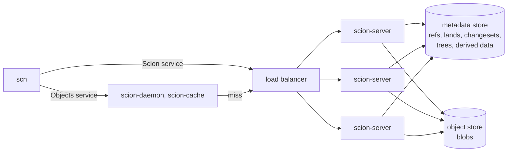
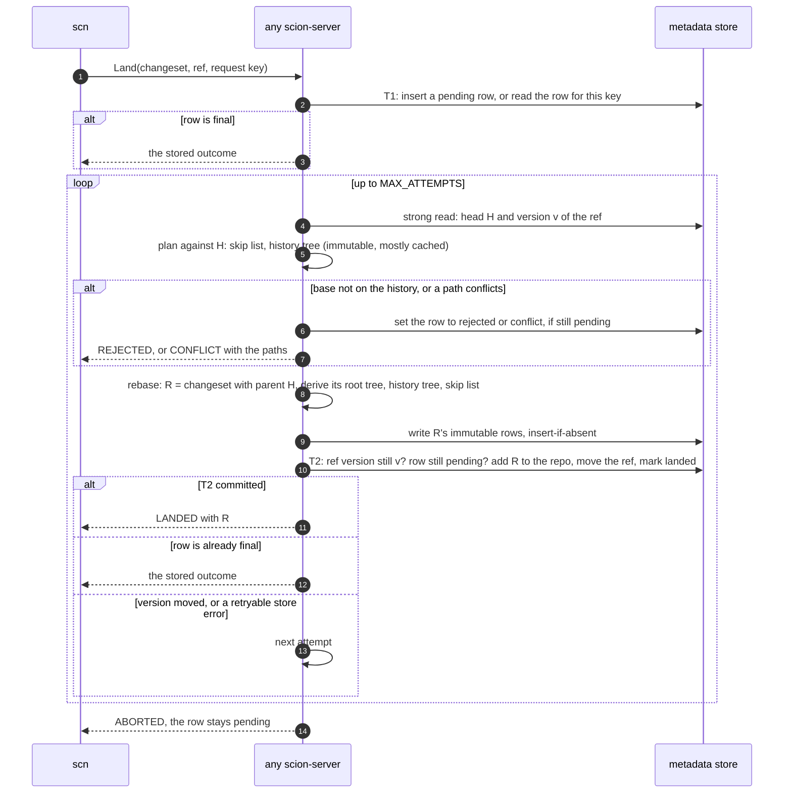

# Design: a backend that scales out

**Status: proposal. Nothing in this file is built.** It answers
[#47](https://github.com/bnsd55/openscion/issues/47). It describes how
openscion could run on many stateless servers that share one metadata store
and one object store, and land changes without a lock in process memory.
[`architecture.md`](../architecture.md) describes the code on `main`, and
[`protocol-v1.md`](../protocol-v1.md) is the contract that this design keeps.

Section 1 quotes Anthropic's article
[Redesigning source control](https://www.anthropic.com/engineering/redesigning-source-control)
word for word. Other quotes say where they come from. Everything else is
this project's proposal, marked **Proposal** where it could be read as a
fact about the article. Numbers marked **estimate** are back-of-envelope
figures, not measurements.

## 1. What the article says

- "In Scion, the repository’s data is distributed, and every component is
  independently scalable; there is no fully materialized copy of the repo
  anywhere, even on the server."
- "The cost of creating a commit and updating its downstream data structures
  has to scale with the size of the change, not the overall size of the repo,
  or the server can’t keep up."
- "This structure lets us accept changesets with very high throughput because
  there are no packfiles to accept, no locking or cross-server coordination,
  and no refs to move around."
- "Scion does technically support refs, but since neither creating nor
  fetching commits involves them, moving one is a compare-and-swap on a single
  Spanner row that happens separately from creating changesets."
- "The development lifecycle in Scion discourages refs (pointers to commits,
  such as branches and tags), except for the main ref or release branches,
  because global state that every server has to agree on is a looming scaling
  problem."
- A changeset holds "content-addressed pointers to the compressed file
  contents in blob storage."
- "All source control data is content-addressed, so a piece of data never
  changes once it’s stored, and any server can cache it without checking with
  the others."
- "As a result, the servers are horizontally scalable and require little
  coordination. They are essentially large caches that can also compute
  derived data on the fly and write the results back to Spanner."
- "When a cache is missing an object, it asks the authoritative
  scion-servers, which read from Spanner or cloud storage as needed."
- "To answer those, Scion builds additional data structures from the
  changesets, including dedicated structures for file blame and path history
  and skip lists for the commit graph."
- "Each type of derived data is defined recursively, so its value for a
  changeset is computed from its values for that changeset’s parents."
- "Second, for each type, we can choose whether to compute it eagerly or defer
  the work, so we avoid materializing data we don’t need."
- On load: "as of September, we merged over 30,000 per day".

**What the article does not say.** It does not say how a land checks for
conflicts, which transactions Scion runs besides the compare-and-swap, what
isolation level it uses, how blob writes are ordered against metadata, or how
derived data is laid out in Spanner. Every answer to those questions below is
this project's proposal.

## 2. v0.1, and why each part does not scale out

v0.1 is one `scion-server serve` process on one machine.

| Part | Today (`main`) | Why it does not scale out |
|---|---|---|
| Metadata | One SQLite file, `<data>/scion.db` (`store.rs`). | It lives on one machine's disk. SQLite takes one writer at a time, and its file locks are not reliable on many network file systems. So other machines cannot share it. |
| Write path | One write connection behind a mutex (`Inner::db`), and 8 read-only connections. Write transactions use `BEGIN IMMEDIATE`. | Every write of every repo waits for one lock. Throughput is that of one connection on one drive. |
| Durability | Group commit: callers share one full drive flush (`GroupFlush`). A read waits if it saw a commit that no flush covers yet. | The counters that decide when to flush (`committing`, `committed`, `flushed`) are in process memory. A commit by another process is not counted. |
| Land lock | One mutex per (repo, ref) in `Lands::refs` (`land.rs`). | A second process does not see it. |
| Path index | `PathIndex`: per ref, in memory, built on the first land and pruned in cycles of 10,000 generations. | Each process builds its own copy for each ref, and a restart loses it. A base more than `MAX_DEPTH` below the tip walks history on each land ([#38](https://github.com/bnsd55/openscion/issues/38)). |
| Blobs | One zstd file per blob in `<data>/objects/blob/` on the local disk. | Other machines cannot read them, and one drive holds the only copy. |
| Land IDs | SQLite row IDs. The newest land row is never deleted, so an ID is never given out twice. | A counter in one file. |
| Data directory | `Store::open` takes `<data>/server.lock`, so one server uses a directory. An import process shares it (`Store::open_shared`). | Both processes are on one machine, and the land lock is in the server's memory. |

**What makes a land correct today.** The compare-and-swap on the ref's
`version` decides each land, not the mutex. `settle` moves the ref only if
the version is the one that `plan` read. The mutex has two other jobs. It
keeps lands to one ref from racing, so no plan is wasted. It also makes two
calls with the same request key wait for each other. Without it, the second
call would plan again, find its own landed copy as a conflict, and fail in
`set_state` with an internal error, because the row is no longer pending.
Section 4.4 keeps that rule without the mutex.

## 3. The target

**Proposal.** Many `scion-server` processes answer both services. Any server
can answer any call. Each one holds only caches and temporary files, so a
restart or a new server loses no data. The cache tiers
([#5](https://github.com/bnsd55/openscion/issues/5)) stay in front of them,
unchanged.



A server keeps memory caches (section 5), spool files of uploads in progress
(a crash may drop them, as today), and its own limits: 256 jobs, 16 uploads,
4 `Blame` calls and the 400 MiB `GetObjects` budget. The totals grow with the
number of servers.

### 3.1 The metadata store: properties, not a product

The article uses Spanner. This design needs these properties:

| ID | Property | Why |
|---|---|---|
| P1 | Transactions across machines. A transaction that writes a row fails if another transaction wrote that row after it read it. | The ref compare-and-swap, and the rule that one request key lands once. |
| P2 | Strong reads: a read sees every transaction that committed before it started. | `ResolveRef` returns where the ref points "now" (protocol section 7.1). `GetLand` must show a land that already replied. |
| P3 | A commit is durable when it is acknowledged, on more than one machine. | The durability rules of protocol section 4. |
| P4 | Insert-if-absent, or a unique key. | Request keys, and content-addressed rows that two servers may write at once. |
| P5 | Point reads by key and ordered range scans. | Lookups by ID, and the expiry of old lands. |
| P6 | A source of IDs that are never reused. | `land_id` (section 4.5). |

Serializable transactions are the simplest to reason about, and Spanner
offers them. Snapshot isolation with write-write conflict checks is also
enough for every transaction in section 4, because two racing lands both
write the ref row, and two calls with one request key both write the land
row. A future check that reads a row it does not write would need
serializable transactions.

**Candidates.** Each can meet P1 to P5. The trade-offs are this
project's reading of each project's documentation. Check the current terms
before choosing.

| Store | Model | Fit | Trade-offs |
|---|---|---|---|
| Spanner | Managed SQL, serializable | The article's choice. | A managed service only. CI and contributors cannot run it locally. |
| CockroachDB | SQL, PostgreSQL wire protocol, serializable by default | The SQLite schema ports with few changes. | Since late 2024 the license is source-available, not open source. Under contention, transactions fail with retry errors that the caller must retry. |
| FoundationDB | Ordered key-value store, strict serializable | Small, short transactions, which is what a land needs. | No SQL: the schema is a layer that this project writes. Limits: 5 s per transaction, 10 MB per transaction, 100 KB per value, 10 KB per key. A large tree must be split across keys. |
| TiKV | Ordered key-value store, snapshot isolation | Enough for section 4 (see above). | Not serializable. Timestamps come from one leader of its placement service, which is one more component to run. |
| YugabyteDB | SQL, PostgreSQL compatible, serializable on request | The SQL ports like CockroachDB. | The default level is snapshot. The backend must ask for serializable, or rely on the argument above. |
| PostgreSQL, with care | One primary, serializable available | Simple to run. Every transaction here is small. | Writes scale up, not out. P3 needs synchronous replication. Replicas lag, so only immutable rows may be read there, and a miss must go to the primary. |

### 3.2 Blobs in an object store

**Proposal.** Each blob is one object, keyed `blob/<64 hex digits>`, with
the same zstd frame as today. The key is the hash of the content, so a
second write of a key writes the same bytes and is harmless. The store must:

- make a put atomic: a reader sees the whole object or nothing,
- acknowledge a put only when it is durable, and show an object only then,
- show an acknowledged object to every later read, from any server,
- let only servers write.

**Ordering rule.** A row may name only data that is already durable. So the
write order is: blobs, then trees, then the changeset, then its derived
values, and last the ref and the land row (section 4.3). A crash at any point
leaves only data that nothing names, never a name without its data. This is
today's rule, "No committed metadata may name a blob that a crash could
lose", made general.

`PutBlob` hashes the stream into a spool file as today, then puts the
compressed object, then replies. `CreateChangeset` checks that each blob it
names exists in the object store (one request per blob, in parallel), and
does not read it back. That is safe only because only servers write the
store, and each server checks the hash before it writes. A blob damaged at rest is then found
when it is read, as every reader checks hashes. The full read-back of today
is an option (open question Q7).

### 3.3 Where each table goes

| Data | Store | Changes after it is written? | Cached on a server |
|---|---|---|---|
| `refs` | metadata | yes, by compare-and-swap | never |
| `lands` | metadata | yes, pending to final, then expired | never |
| `repos` | metadata | rows are only added, by import | rows found, yes |
| `changesets`, `changeset_parents` | metadata | no | yes |
| `repo_changesets` | metadata | rows are only added | rows found, yes |
| `trees` | metadata (Q2) | no | yes |
| `derived`, and large derived structures in their own tables | metadata | no | yes |
| `git_import` | metadata | rows are only added | no |
| blobs | object store | no | yes, and in the tiers |

No server ever caches "not found": a row that is missing now can exist a
moment later.

## 4. Land without a process-local lock

### 4.1 Durable path history

**Proposal.** The in-memory `PathIndex` becomes derived data: a kind
`path_history`, computed through `derived.rs` like `root_tree`. Its value
for a changeset C is the ID of a *history tree* over C's first-parent
history. A history tree has the same shape as a tree. Each entry of a node
holds:

- `file_gen`: the generation of the newest first-parent changeset that put
  or deleted this path as a file, symlink or submodule, if any,
- `dir_gen`: the generation of the newest one that changed anything below
  this path, if any,
- the child node, when `dir_gen` is set.

A deleted path keeps its entry, because the conflict rules need to see a
delete after the base. Nodes are content-addressed with their own domain
prefix and are never sent to a client. The value for C is the first parent's
history tree, with `file_gen` set to C's generation on each path that C
changes, and `dir_gen` set on each directory above it. Like `tree::apply`, it
rewrites only the nodes on changed paths. It is eager: a land writes it for
the changeset it lands.

The check is today's three rules, read from the head's history tree. A
changed path P conflicts when `file_gen(P)`, `dir_gen(P)`, or `file_gen(D)`
for a directory D above P is greater than the base's generation. One walk
from the root along P reads all three. So the check reads about one node per
part of each changed path, whatever the age of the base. The proof in
architecture section 5 still holds: generations strictly increase along first
parents, and the history tree covers the whole first-parent history, not a
window. So pruning, `MAX_DEPTH` and the old-base walk go away
([#38](https://github.com/bnsd55/openscion/issues/38),
[#75](https://github.com/bnsd55/openscion/issues/75)).

The same tree answers path history. `file_gen` or `dir_gen` of a path is the
generation of the next `Log` entry, and the skip list (section 4.2) finds that
changeset, with no scan ([#61](https://github.com/bnsd55/openscion/issues/61)).

```text
history tree of H (gen 13), base B has gen 10
  ""     dir_gen 13
  a.rs   file_gen 11                land of a.rs:  11 > 10  conflict
  b/     dir_gen 12                 land of b:     12 > 10  conflict
    c.rs file_gen 12
  d.rs   file_gen 4                 land of d.rs:   4 <= 10 lands on H
  e.rs   file_gen 13
```

### 4.2 The base check

The base B must be on the head's first-parent history. **Proposal.** A
first-parent skip list as derived data
([#72](https://github.com/bnsd55/openscion/issues/72)), for example one
extra jump pointer per changeset in a skew-binary scheme. From the head, the
server finds the first-parent ancestor at B's generation in O(log n) reads,
and compares it with B. The article keeps "skip lists for the commit graph".
This proposal needs only a first-parent one for lands. The commit graph on
`main` (`graph.rs`) now keeps that skip list, but the land check does not
read it yet.

Both kinds are keyed by changeset, not by ref. A new ref, or an import that
moves a ref to a descendant through a second parent, needs no rebuild: the
new head has its own values.

### 4.3 The land, step by step



**How the rebased changeset is written.** R is the input changeset with its
parent replaced by the head H, as today. If the base is the head, R is the
input changeset and nothing new is written. Otherwise:

1. Derive R's eager values from H's: apply the changes to H's root tree, then
   update H's history tree and skip list. If the changes do not apply, the
   land is `CONFLICT` with no paths, as today.
2. Write the new trees, the changeset row and its parent rows, and the
   derived rows for R. Each write is insert-if-absent. A second write must
   equal the first, or the store reports corruption, as today. R is not yet
   in `repo_changesets`, so no read in the repo can see it.
3. T2 adds R to `repo_changesets`, moves the ref and marks the land landed.

If T2 loses the race, R's rows stay and nothing names them. The next attempt
rebases onto the new head, so it makes a different changeset.

### 4.4 Why it is correct

- **The head did not move.** T2 reads the ref row and writes it. By P1, if
  another transaction moved the ref after the plan's read, T2 sees a new
  version or fails. So when T2 commits, H is still the head.
- **The plan is still true.** The plan reads only data keyed by H: H's skip
  list and history tree. That data never changes. So the plan's answer is the
  answer for the head at commit.
- **Nothing dangles.** Every row that T2 names was written and acknowledged
  before T2 started (section 3.2).
- **One land per key.** Every write of the land row, in T2 or for a conflict
  or rejection, requires the row to be pending. Two calls with the same key
  both write that row, so by P1 at most one finishes it. The other finds the
  row final and returns the stored outcome. This replaces the mutex's second
  job (section 2).
- **Conflicts and rejections need no compare-and-swap.** As the ref moves
  forward along first parents, a path changed after the base stays changed
  after the base, and a base off the history stays off it. So the outcome is
  true for a head that the ref held during the call, as today.

### 4.5 Retries, ABORTED and unknown commits

- A retryable store error in T2 (a serialization failure or a write-write
  conflict) is handled like a moved version: nothing committed, so the
  server plans again.
- **Unknown commit result.** A store can fail a commit without knowing
  whether it applied, for example when a connection drops during commit. The
  server plans again. That is safe whatever happened. The old commit and the
  new one write the same ref row and land row, so by P1 at most one applies.
  If the old one applied, the new plan finds the land row final and returns
  the stored outcome (section 4.4). A pending row does not prove that the
  old commit failed: some stores can still apply it later.
- A transaction body may run more than once, so it must not change anything
  outside the transaction.
- **Land IDs** (P6). Two options. A random 63-bit ID spreads writes, but can
  repeat after a row expires, with a very small chance. A store sequence
  that never repeats keeps the protocol's "never the same ID" rule exactly.
  Some of the stores above offer sequences that do not put new rows in one
  key range. Q4.
- **Expiry** moves out of the land path, to a background job with bounded
  deletes, or to a time-to-live feature of the store. So a land deletes
  nothing. The 7-day rule stays. An index on `finished_at` has its keys in
  time order, so every land writes to its newest range. A hashed index
  spreads that.

### 4.6 What gets cheaper, and what costs more

**Estimates.** One region, a store with three replicas, and 5 to 15 ms per
read-write commit.

| Step | Today, one machine | Proposal |
|---|---|---|
| T1, record | local transaction | one commit, 5 to 15 ms |
| Plan | in-memory index, or a history walk for an old base | one strong read, plus about one node per path part, mostly in cache |
| Rebased rows | in T2 | one batch write, 5 to 15 ms |
| T2, move the ref | local transaction | one commit, 5 to 15 ms |
| Durable reply | wait for a shared full drive flush | the commit is durable |
| One land | not measured | 15 to 45 ms |
| One ref | measured: about 200 durable lands/s with 200 agents ([README](../../README.md)) | about 50 lands/s without batching (below) |

**One ref is one row.** Let `t` be the time from the plan's read of the head
to T2's commit, about 20 ms. Without batching, one ref takes at most about
1/`t` = 50 lands per second. The article reports more than 30,000 merges per
day, about 0.35 per second on average. If all of them land on one ref, and
the peak is 10 times the average (3.5 per second), that is about 14 times
headroom.

**Lost races.** With lands arriving at rate λ, a land loses one attempt with
a chance of about 1 − e^(−λ·t), and all 3 attempts with about the cube of that.
This model treats each attempt as independent, so it is rough.

| λ (lands/s on one ref) | One attempt lost | All 3 lost (`ABORTED`) |
|---|---|---|
| 3.5 | 7% | 0.03% |
| 25 | 39% | 6% |
| 50 | 63% | 25% |

Past about 20 lands per second on one ref, plain retries are not enough. The
fix then is a lander that rebases a batch of pending lands and moves the ref
once ([#18](https://github.com/bnsd55/openscion/issues/18), closed until a
measurement shows the need). Across servers, one server holds a lease per
ref in the store and runs the lander for it. Correctness still comes only
from the compare-and-swap: two landers at once waste work, but land nothing
twice.

**Cheaper than today.**

- `PutBlob`, `CreateChangeset` and every read stop sharing the connections
  of one process.
  They scale with the number of servers.
- A restart loses nothing. Today the first land per ref after a restart
  rebuilds the path index.
- A land on an old base costs the same as one on a new base (#38).
- Import can run while servers serve, as one more writer that moves a ref by
  compare-and-swap (#27).

**More expensive than today.**

- Each land is three network commits instead of two local transactions, and
  one ref takes about 50 lands per second, not about 200 (table above).
- Each changeset also writes its history nodes, about one per path part of
  each changed path. For 5 changed paths 6 levels deep that is up to 30 tree
  rows and 30 history rows, about 65 rows in all. At 30,000 lands per day
  that is about 2 million rows per day, or about 23 per second
  (**estimate**).
- A blob check is a network request, not a local file read.
- Running a database cluster and an object store costs more than one file.

## 5. Derived data and caches across servers

- **Any server derives.** A value is keyed by (kind, version, changeset), and
  never changes. The server that needs a missing value derives it and writes
  it back, as the article describes. Two servers may derive the same value at
  once. Both write the same bytes, so this wastes work but is safe.
- **Eager kinds before the ref.** `root_tree`, `path_history` and the skip
  list are written before T2 (section 4.3). So every head that any server can
  read already has them, and the next land needs no derivation. Git import
  writes them for each changeset, as it does `root_tree` today.
- **Deferred kinds** derive on first read, as today. A long backfill must run
  in bounded batches, one transaction each
  ([#71](https://github.com/bnsd55/openscion/issues/71)). On FoundationDB
  this is required by its 5 s limit. A lease per (kind, version) can stop two
  servers from doing the same backfill. The lease only saves work.
- **Durable before the reply.** A commit in a store with P3 is durable when
  it returns. So `Store::flush`, and the wait in `Store::read`, have nothing
  to do in that backend.
- **Caches.** Each server keeps a bounded memory cache of changesets, trees,
  derived values and history nodes, and of `repo_changesets` rows it found.
  These never change, so the cache needs no invalidation, as the article says
  of content-addressed data. The top nodes of a hot ref's history tree are
  read by every land, so they stay in cache. Refs and land rows are never
  cached. A miss is read from the store, never answered as `NOT_FOUND` from
  the cache.
- **Tiers.** `scion-cache` and `scion-daemon` follow protocol section 8, with
  no change. A miss reaches any server.

## 6. Migration from v0.1

Each step is one small pull request, and every step before the last runs on
one machine.

1. **Queries behind functions.** Move the SQL of `land.rs` (lands) and
   `import.rs` (git import) into `db.rs`, so that every module calls named
   queries. No change in behavior.
2. **Path history as derived data**, on SQLite (#61, #38). `land.rs` checks
   the head's history tree. `PathIndex`, its pruning and `MAX_DEPTH` are
   removed. This helps one machine too.
3. **First-parent skip list** for the base check (#72).
4. **No lock in process memory.** Remove `Lands::refs`. T2 checks that the
   row is pending and returns a final row, instead of failing in
   `set_state`. Transaction bodies may run again. Test with two `Lands`
   values on one store, as two servers.
5. **A blob store trait**, with the blob folder and an object store. The
   trait comes with its second implementation, not before.
6. **A metadata trait** behind `store.rs`, with SQLite and one distributed
   backend, again in one change. A sketch:

   ```rust
   pub trait Meta: Send + Sync + 'static {
       type Tx<'a>: MetaTx where Self: 'a;
       /// Runs `f` in one transaction. `f` may run again on a retryable error.
       fn transact<T>(&self, f: impl FnMut(&mut Self::Tx<'_>) -> Result<T>) -> Result<T>;
   }
   // MetaTx: the queries of step 1 (get_ref, cas_ref, get_tree, put_derived, ...).
   ```

   The trait stays synchronous, because every caller already runs on a
   blocking thread. An async store client then blocks that thread until its
   call returns. The ceiling is one thread per request in flight, at most
   256 now. The upgrade is an async trait, which changes every caller.
7. **Many servers.** Run several servers on one store. `scn bench` across
   them must find every landed change on the ref exactly once. To move
   existing data, a tool stops the old server, then copies blobs, immutable
   rows (children before parents), and last refs and lands, through the
   traits.

**Tests to reuse.** The land tests in `land.rs` become backend tests that
run on both backends: `a_crash_at_any_step_lands_exactly_once_on_retry`,
`retry_with_the_same_key_returns_the_same_land`,
`concurrent_lands_all_land_exactly_once`,
`overlapping_paths_conflict_and_leave_the_ref_alone`,
`lands_after_a_merge_that_made_the_old_tip_a_second_parent`, and the
retention tests. The pruning tests become old-base tests on the history tree.
`root_trees_match_golden_ids` pins the trees on both backends. The
conformance suite ([#60](https://github.com/bnsd55/openscion/issues/60))
runs the same calls against SQLite, the distributed backend and the tiers,
and must get the same answers. Its fault injection gains two faults:
a retryable error and an unknown result at each commit.

**The protocol.** No call, field, state, status code or limit changes. Some
sentences in [`protocol-v1.md`](../protocol-v1.md) describe one server and
need new wording:

- Section 6.3: "Lands to one ref run one at a time" becomes "commit one at a
  time", and "in v1 only git import does this" becomes "another land or an
  import". `ABORTED` keeps its meaning. The number of attempts can change.
- Section 4: "on disk" means "durable in the metadata store". The rules stay.
- Section 2: the queue limits are per server.
- A deployment across machines needs TLS
  ([#14](https://github.com/bnsd55/openscion/issues/14)).

## 7. Risks and open questions

**Risks.**

| ID | Risk | Mitigation |
|---|---|---|
| R1 | One ref is one hot row. Past about 20 lands per second on one ref, plans are wasted and `ABORTED` grows (section 4.6). | A batch lander with a lease (#18). More attempts with backoff. |
| R2 | A store client that hides an unknown commit result, or retries a commit on its own, hides the case in section 4.5 from the server. | Use clients that report it. Inject this fault in #60. |
| R3 | A large directory is one tree, rewritten on every change below it. Some stores limit one value (FoundationDB: 100 KB). | Split large tree rows across keys in that backend. The object format does not change. |
| R4 | A stale read returns an old head, or a false `NOT_FOUND`. | Strong reads for refs and lands (P2). A cache miss goes to the store. |
| R5 | Rows that nothing names (lost races, dropped writes) are never collected. | One rebased changeset per lost race, so the growth is small. Collection is Q8. |
| R6 | History trees keep deleted paths forever. | Bounded by the paths that ever existed. Measure on a real import first. |
| R7 | SQLite shared by two processes (#27) breaks the read-side flush rule where a plain `fsync` can leave a commit in the drive cache. The rule counts only this process's commits. | Full flush on every commit in that mode, or no separate importer process for SQLite. |
| R8 | Time-based rules (`finished_at`) on servers with different clocks. | Use the store's clock in the transaction. |

**Open questions.**

| ID | Question |
|---|---|
| Q1 | Which distributed backend first? FoundationDB is strict serializable, and the small transactions here fit its limits. A SQL store keeps the schema close to SQLite. |
| Q2 | Trees in the metadata store, as today, or in the object store? The metadata store gives one batch write per land. The object store gives cheaper bytes and a put per tree. |
| Q3 | Keep T1? Folding the pending row into T2 saves one commit per land (5 to 15 ms, **estimate**). But `GetLand` could then not show `PENDING`, and protocol section 6.3 says the first call records the land. |
| Q4 | Land IDs: a sequence, a random ID, or a time-based ID (section 4.5). |
| Q5 | Per-principal quotas ([#15](https://github.com/bnsd55/openscion/issues/15)) need counters that all servers share. Where do they live? |
| Q6 | Several regions: the ref row has one home. A land from a far region pays a cross-region commit, about 50 to 200 ms (**estimate**). |
| Q7 | `CreateChangeset`: check that each blob exists (cheap), or read it back and hash it (today, safe if others can write the store)? |
| Q8 | Collection of rows and blobs that nothing names, and of old derived versions (#71). |
